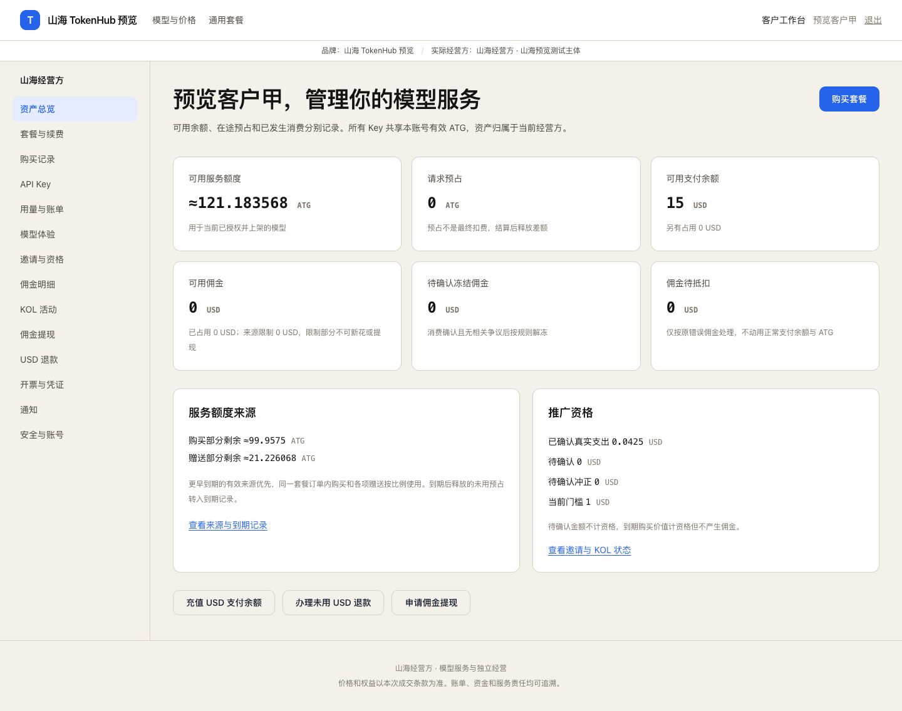
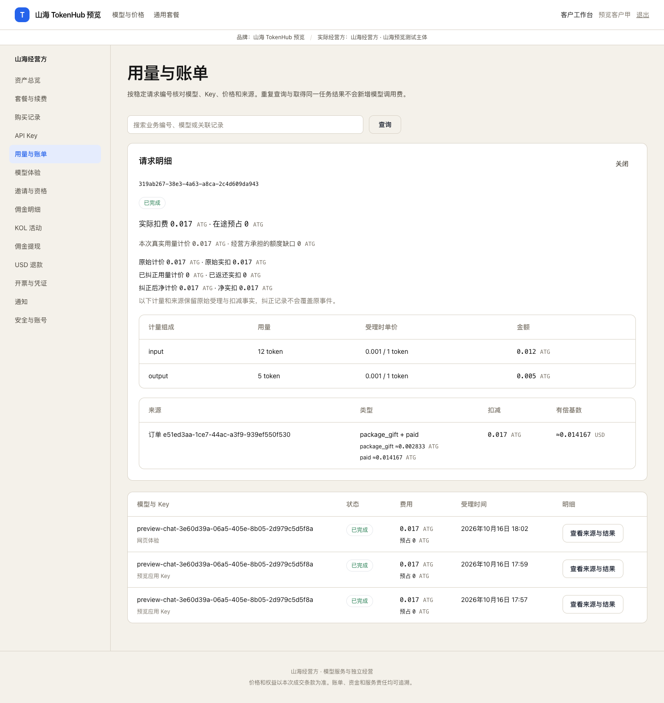
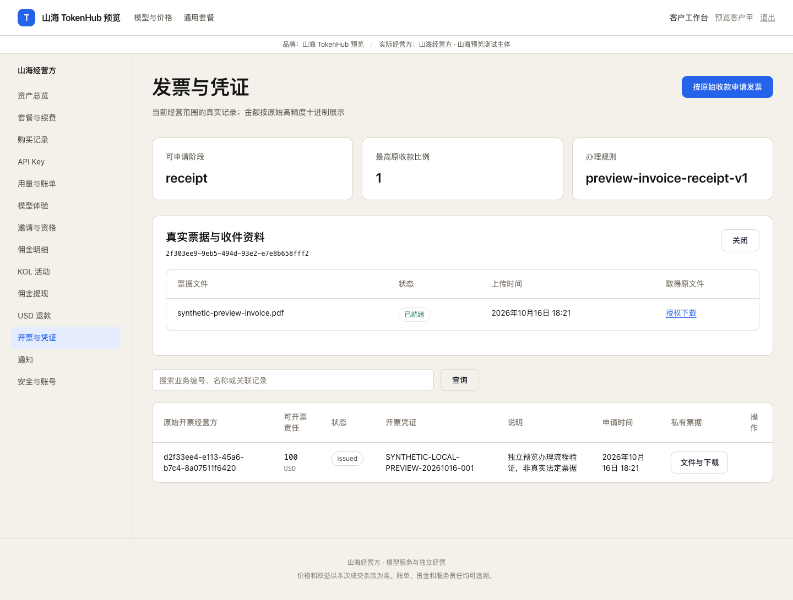

# Foundation / Portal / Web 实施与验证证据

更新：2026-10-16。本文件为独立证据，不覆盖实施记录，也不表示 W01/W08 或 A001—A135 已全部验收。没有提交、推送或发布。

## 最终收敛状态

本代理负责的页面、API、持久任务及契约没有已知未实现功能项。以下“待浏览器验证”是证据覆盖不足，不是保留空实现；各领域守恒、并发与故障用例见同目录另外三份验收证据及主代理统一全仓结果。未将全部135个案例宣称已通过。

最终生产Next构建、TypeScript检查、12个Vitest用例、7个Playwright契约用例通过（最后一轮7.8秒）。契约测试使用独立前端fixture；下面实际Chrome预览完全不拦截请求。OpenAPI为198条路径、177份Schema，111份经营写入元数据均展开明确DTO；`node scripts/refactor-openapi.cjs --check`只在内存生成，校验所有引用、逐字比较，缺失或漂移非零且不改文件。8份旧固定token/admin契约已移除。

实际Chrome补充闭环：

- A081通过受限客户选择器发放1.234567890123456789 ATG独立补偿，返回`delivered`；金额提交完整，不改原订单/现金，独立赠送来源有原始授权与事实依据。
- 平台发布已核实资产与网络版本，钱包商户从真实选择器选择该版本，无经营方自行声明网络/合约/小数位。客户订单页提交真实协议RPC交易线索；原币事实已保留但旧估值不覆盖真实付款时间时返回`receipt_awaiting_valuation`，未提前入账或交付。财务页面补有证据的实际付款时点估值后返回`recorded/version1`，worker最终交付5 USD充值。这里的USDT及汇率1均是明确合成协议事实，不代表真实资产或固定锚定估值。
- 真实退款责任10 USD先实际清偿9、剩余1保持占用。封存已结束原指令后，客户页面重新指定银行目的地，财务页面独立核实；当前责任经营方用自身新银行配置登记实际补付1，最终`completed/settled10/remaining0/route2`，两轮授权历史保留。不是自动发送真实银行或链上转账。
- 实际客户最终资产121.183567890123456789 ATG、15 USD；主页面最多6位近似显示，极小非零显示小于0.000001，完整值保留在aria/title且可双击复制。输入、提交、限额判断不舍入、不用JS浮点金额计算。
- 请求实际HTTP返回原始`actual_atg/charged_atg`、纠正`corrected_atg/corrected_charged_atg`、净额`net_actual_atg/net_charged_atg`六个十进制字符串。列表显示净实扣，明细保留原受理计量、原扣减来源及纠正差额；本预览账单无错误扣费，纠正均为0，真实纠错守恒由主代理领域专项证明。

最后实际流程发现并修复：隐藏目的地同意值曾序列化字符串（现为布尔并有回归）；退款行追加的原指令/最新提案未写回Entity投影（现可跨页操作）；已保留部分付款曾误报500（现409明确复核）；已知原支付时点不能被浏览器分钟精度重提改写（页面只展示，只有原事实缺时间时补证）；经营概览新责任投影必须使用外层事务（定点真实PG-race9.069秒通过）。

正式注销已接：所有历史客户订单按原经营方分组，未入账原币事实及已入账未分配收款均为`pending_receipts`强门槛；采购款不混入客户。纯赠送在正式关闭的同一事务失效，购买余额仍须使用、到期或本人明确放弃，USD/佣金不被销毁。主代理验证了纯gift关闭、保留现金、失败回滚与幂等；尚无完整客户关闭浏览器矩阵。

外部材料限制仅包括真实供应商/支付商户验收、真实Cloudflare账号与独立域名DNS/TLS、法定发票办理。现有真实驱动、配置预检、待配置状态及独立协议/S3/SMTP证明均不把这些材料限制伪装成已实测。

## 独立实际预览

- Web：http://127.0.0.1:13003；API：http://127.0.0.1:18081；worker内部健康：http://127.0.0.1:18082/readyz。
- 专用数据库：tokenhub_preview_20261016_foundation_0849。专用私有桶：tokenhub-preview-foundation-20261016-0849。未改本地 .env，未复用共享测试或备份库。
- 独立Docker协议服务18090；预览SMTP catcher18028只接受 example.test 测试收件人，没有外发。真实供应商和支付商户材料仍待配置，协议验证不等于真实商户验收。
- 本机浏览器脚本、程序和日志位于 /private/tmp/tokenhub-preview-foundation-20261016/。会话和Key材料仅供本机合成测试，不写入本证据。

实际 Chrome 没有请求拦截：员工登录，表单发布规则、Stripe形状商户和100+20套餐，真实目录HTTP配置，表单开业检查，客户注册，真实SMTP邮件验证，客户登录，100USD充值真实协议建单与查询，worker到账，页面用余额购包，页面创建Key，标准模型HTTP调用及同键重试，网页体验，实际账单。

第一轮三次不同模型调用共扣0.051 ATG。重复HTTP不另扣，当时余额119.949 ATG，购买来源99.957499999999999999，赠送来源19.991500000000000001。原100USD购包后支付余额为0。请求明细为12输入token、5输出token、0.017ATG，保留购赠分摊和有偿基数的高精度。

票据实际 Chrome：设置receipt阶段开票规则，客户按原收款申请100USD，经营方上传明确标记合成测试的PDF至私有S3，登记合成办理凭证，同客户授权下载，HTTP200且文件字节一致。这是权限和办理流程验证，不是法定开票。

其它实际截图：[独立补偿赠送](evidence/foundation/gift-issued.png)、[平台支付组合发布](evidence/foundation/asset-network-published.png)、[钱包商户选择平台组合](evidence/foundation/wallet-merchant-platform-asset.png)、[原币已保留待估值](evidence/foundation/wallet-actual-awaiting-valuation.png)、[财务补付款时点估值](evidence/foundation/wallet-finance-valuation-confirmed.png)、[客户剩余款新目的地](evidence/foundation/refund-customer-new-route.png)、[财务独立授权](evidence/foundation/refund-finance-new-authorization.png)、[退款完成及历史](evidence/foundation/refund-completed-history.png)、[最终财务报表](evidence/foundation/financial-report-final.png)、[路由策略与健康](evidence/foundation/routing-final.png)。全部只含本机合成业务数据，没有会话、完整Key或商户密钥截图。

## W01/W08 接线边界

| 工作项 | 代码和实际证据 | 仍待完整验收 |
| --- | --- | --- |
| W01身份、会话、CSRF、权限、Host | portal/auth.go、http.go、staff.go、config.go；真实PG-race身份和注册；实际Chrome SMTP注册登录 | 跨品牌、全部staff角色和关闭状态的完整浏览器矩阵 |
| W01迁移、持久任务和消息 | platform/db checksum、依赖plan、readiness；jobs租约/fence/dead-letter；outbox事务inbox；portal/worker.go durable schedules | 主代理真实子进程SIGKILL/租约恢复/fence演练8.472秒通过；最终总验收另见主代理记录 |
| W08角色工作台和经营动作 | web/components/product；portal/resources.go、commands.go、presentation.go、references.go；隐藏CAS版本、真实选择器和驱动材料联动 | 下表标明仍需专项浏览器验证；不能仅编译判完成 |
| W08主题、域名和Logo | portal/assets.go、domains.go、tls.go与branding真实Cloudflare/DNS/TLS/S3服务；Caddy内部ask限官方或已验证域名 | 合法外部域名的真实DNS/TLS配置尚未纳入本预览 |
| W08通知、报表、票据、导出和保留 | portal/operations.go、financial.go、invoice_files.go、worker.go；真实领域数据源和私有S3票据；独立财务报表 | 全部预警升级、通知偏好、导出撤权、历史issuer重开浏览器流程 |
| W08可观测性、限流和对象存储 | Application注入RedisLimiter/ObjectStore/Metrics；API和worker readiness；HTTP OTel和授权metrics；migrate显式生命周期配置；持续负载、SSE/异步、实际容器HTTPS及备份恢复已完成，见《账本调用与运行验收证据》 | 不把共享开发机压测当成正式商业硬件容量结论；真实外部通道/域名及完整浏览器矩阵仍区分验收 |

## 已运行验证

- 早期Portal包真实依赖回归：go test -race ./internal/portal -count=1，70.242s通过；后续全部7个客户workspace实际HTTP回归14.147s、经营读取及写重放专项9.069s通过。包通过不表示所有opt-in外部用例都已启用，最终逐项结果以主代理当前回归记录为准。
- 私有金融凭据：真实S3密文，同业务key重复不新增，异内容冲突，授权下载和越权拒绝。
- Web类型检查通过；Vitest四文件十二例通过，含未知结果同key、隐藏版本、权限数组回填、切换驱动不提交旧材料、隐藏授权布尔值和高精度简洁金额边界。
- 最终生产build后七例浏览器契约测试7.8秒通过。它们是前端契约测试，不替代本文件的实际预览。
- OpenAPI移除八份旧admin/token契约，新增模型、核心客户和经营写入的明确DTO。生成器为scripts/refactor-openapi.cjs，最终198条路径、177份Schema、111份经营写入元数据及--check全引用校验通过。

## A001—A135 页面与接线映射

以下“已接”只表示页面和领域服务接线存在，不表示完整业务案例已通过。金融守恒、并发、故障和领域专项必须与各owner证据合并。没有专项浏览器证据的项目保留待验。

| ID | Case | Code | Evidence / remaining acceptance |
| --- | --- | --- | --- |
| A001 | 同邮箱跨品牌注册 | portal/auth.go,http.go,staff.go; web/auth.tsx | Real PG identity/CSRF/scope and registration replay; actual SMTP registration. Full cross-brand/browser matrix pending. |
| A002 | 同品牌相同已验证邮箱再次注册其他渠道 | portal/auth.go,http.go,staff.go; web/auth.tsx | Real PG identity/CSRF/scope and registration replay; actual SMTP registration. Full cross-brand/browser matrix pending. |
| A003 | 分别使用用户码、渠道码和无代码注册 | portal/auth.go,http.go,staff.go; web/auth.tsx | Real PG identity/CSRF/scope and registration replay; actual SMTP registration. Full cross-brand/browser matrix pending. |
| A004 | 使用无效或其他品牌代码 | portal/auth.go,http.go,staff.go; web/auth.tsx | Real PG identity/CSRF/scope and registration replay; actual SMTP registration. Full cross-brand/browser matrix pending. |
| A005 | 链接预填后手动修改邀请码 | portal/auth.go,http.go,staff.go; web/auth.tsx | UI contract test validates final explicit invitation; real registration PG verifies binding. Full matrix pending. |
| A006 | 重试注册及验证回调 | portal/auth.go,http.go,staff.go; web/auth.tsx | Real PG registration replay and verification recovery passed. |
| A007 | 已有账号打开其他推广链接或修改邮箱 | portal/auth.go,http.go,staff.go; web/auth.tsx | Real PG identity/CSRF/scope and registration replay; actual SMTP registration. Full cross-brand/browser matrix pending. |
| A008 | 跨经营方购买或使用 Key | portal/auth.go,http.go,staff.go; web/auth.tsx | Real PG identity/CSRF/scope and registration replay; actual SMTP registration. Full cross-brand/browser matrix pending. |
| A009 | 尝试同经营方转余额、过户或合并账号 | portal/auth.go,http.go,staff.go; web/auth.tsx | Real PG identity/CSRF/scope and registration replay; actual SMTP registration. Full cross-brand/browser matrix pending. |
| A010 | 核查独立收款 | portal/auth.go,http.go,staff.go; web/auth.tsx | 真实浏览器品牌/实际经营方和商户信息展示已通过。平台直售、平台→OEM→客户、平台→渠道→客户、平台→OEM→渠道→客户四条销售链已完成真实PostgreSQL+Bifrost+S3联调，含逐边库存不足和下级成本导出隔离，见《账本调用与运行验收证据》；四条链的全部角色页面未逐一跑浏览器。 |
| A011 | 平台、OEM、渠道分别创建下属 | portal/commands.go,references.go,routing.go,models.go; web/management.tsx | Actual management HTTP reads and opening checks; catalog/runtime domain evidence belongs to root/catalog owner. Full per-case browser acceptance pending. |
| A012 | 部分配置未完成时开业 | portal/commands.go,references.go,routing.go,models.go; web/management.tsx | 真实Chrome注册、新购、调用、activity开业检查已过。organization/TestPostgresStaffOpeningAndIndependentBusinessStatuses验证无校验器/依赖缺项拒开及项目独立；全部依赖排列的浏览器矩阵尚未逐一跑，不存在未接的开业空实现。 |
| A013 | 暂停新增业务 | portal/commands.go,references.go,routing.go,models.go; web/management.tsx | Actual management HTTP reads and opening checks; catalog/runtime domain evidence belongs to root/catalog owner. Full per-case browser acceptance pending. |
| A014 | OEM 继续授权模型 | portal/commands.go,references.go,routing.go,models.go; web/management.tsx | Actual management HTTP reads and opening checks; catalog/runtime domain evidence belongs to root/catalog owner. Full per-case browser acceptance pending. |
| A015 | OEM 或渠道尝试自带供应商密钥或新建公开模型 | portal/commands.go,references.go,routing.go,models.go; web/management.tsx | Actual management HTTP reads and opening checks; catalog/runtime domain evidence belongs to root/catalog owner. Full per-case browser acceptance pending. |
| A016 | 客户列出可用模型 | portal/commands.go,references.go,routing.go,models.go; web/management.tsx | Actual management HTTP reads and opening checks; catalog/runtime domain evidence belongs to root/catalog owner. Full per-case browser acceptance pending. |
| A017 | 手动定价与自动跟随调整 | portal/commands.go,references.go,routing.go,models.go; web/management.tsx | Actual management HTTP reads and opening checks; catalog/runtime domain evidence belongs to root/catalog owner. Full per-case browser acceptance pending. |
| A018 | 限时模型价格结束 | portal/commands.go,references.go,routing.go,models.go; web/management.tsx | Actual management HTTP reads and opening checks; catalog/runtime domain evidence belongs to root/catalog owner. Full per-case browser acceptance pending. |
| A019 | 上游不支持请求所需能力 | portal/commands.go,references.go,routing.go,models.go; web/management.tsx | Actual management HTTP reads and opening checks; catalog/runtime domain evidence belongs to root/catalog owner. Full per-case browser acceptance pending. |
| A020 | 路由故障切换和紧急停用 | portal/commands.go,references.go,routing.go,models.go; web/management.tsx | Actual management HTTP reads and opening checks; catalog/runtime domain evidence belongs to root/catalog owner. Full per-case browser acceptance pending. |
| A021 | 批发订单未足额付款 | portal/procurement.go,exits.go,coverage.go,worker.go | Actual domain procurement/coverage evidence belongs to root/catalog owner. Full procurement browser lifecycle pending. |
| A022 | 长期持有采购余额 | portal/procurement.go,exits.go,coverage.go,worker.go | Actual domain procurement/coverage evidence belongs to root/catalog owner. Full procurement browser lifecycle pending. |
| A023 | 不同买方采购相同数量 | portal/procurement.go,exits.go,coverage.go,worker.go | Actual domain procurement/coverage evidence belongs to root/catalog owner. Full procurement browser lifecycle pending. |
| A024 | 采购含赠送并部分消费 | portal/procurement.go,exits.go,coverage.go,worker.go | Actual domain procurement/coverage evidence belongs to root/catalog owner. Full procurement browser lifecycle pending. |
| A025 | 多次补货后查看历史成本 | portal/procurement.go,exits.go,coverage.go,worker.go | Actual domain procurement/coverage evidence belongs to root/catalog owner. Full procurement browser lifecycle pending. |
| A026 | 采购退款或承接价与账面成本不同 | portal/procurement.go,exits.go,coverage.go,worker.go | Actual domain procurement/coverage evidence belongs to root/catalog owner. Full procurement browser lifecycle pending. |
| A027 | 超卖额度为零时销售 | portal/procurement.go,exits.go,coverage.go,worker.go | Actual domain procurement/coverage evidence belongs to root/catalog owner. Full procurement browser lifecycle pending. |
| A028 | 使用正超卖额度销售后真实余额不足 | portal/procurement.go,exits.go,coverage.go,worker.go | Actual domain procurement/coverage evidence belongs to root/catalog owner. Full procurement browser lifecycle pending. |
| A029 | 同时售卖多个套餐、发放赠送或续费 | portal/procurement.go,exits.go,coverage.go,worker.go | Actual domain procurement/coverage evidence belongs to root/catalog owner. Full procurement browser lifecycle pending. |
| A030 | 计算多级经营责任 | portal/procurement.go,exits.go,coverage.go,worker.go | Actual domain procurement/coverage evidence belongs to root/catalog owner. Full procurement browser lifecycle pending. |
| A031 | 调价、新增模型或接近采购阈值 | portal/procurement.go,exits.go,coverage.go,worker.go | Actual domain procurement/coverage evidence belongs to root/catalog owner. Full procurement browser lifecycle pending. |
| A032 | 自动补货失败、重试或报价变差 | portal/procurement.go,exits.go,coverage.go,worker.go | Actual domain procurement/coverage evidence belongs to root/catalog owner. Full procurement browser lifecycle pending. |
| A033 | 配置套餐范围 | portal/orders.go,renewals.go; web/customer-plans.tsx | Actual Stripe callback PG plus real Chrome wallet purchase; renewal and all funding combinations still need browser matrix. |
| A034 | 新模型上架或单模型下架 | portal/orders.go,renewals.go; web/customer-plans.tsx | Actual Stripe callback PG plus real Chrome wallet purchase; renewal and all funding combinations still need browser matrix. |
| A035 | 月末、闰年、季度和年度生效 | portal/orders.go,renewals.go; web/customer-plans.tsx | Actual Stripe callback PG plus real Chrome wallet purchase; renewal and all funding combinations still need browser matrix. |
| A036 | 多份套餐并存并消费 | portal/orders.go,renewals.go; web/customer-plans.tsx | Actual Stripe callback PG plus real Chrome wallet purchase; renewal and all funding combinations still need browser matrix. |
| A037 | 单期额度提前用完 | portal/orders.go,renewals.go; web/customer-plans.tsx | Actual Stripe callback PG plus real Chrome wallet purchase; renewal and all funding combinations still need browser matrix. |
| A038 | 到期但仍有在途预占 | portal/orders.go,renewals.go; web/customer-plans.tsx | Actual Stripe callback PG plus real Chrome wallet purchase; renewal and all funding combinations still need browser matrix. |
| A039 | 使用直接付款、余额、佣金或组合购买 | portal/orders.go,renewals.go; web/customer-plans.tsx | 真实浏览器100 USD余额购买并交付100+20 ATG已通过；四条经营销售链的真实HTTP/账务联调已通过。直接付款、余额、佣金及各混合资金比例的完整浏览器排列未逐一验证，不能把经营链验证等同于全部资金组合浏览器覆盖。 |
| A040 | 续费资金不足 | portal/orders.go,renewals.go; web/customer-plans.tsx | Actual Stripe callback PG plus real Chrome wallet purchase; renewal and all funding combinations still need browser matrix. |
| A041 | 开关佣金补足续费 | portal/orders.go,renewals.go; web/customer-plans.tsx | Actual Stripe callback PG plus real Chrome wallet purchase; renewal and all funding combinations still need browser matrix. |
| A042 | 关闭自动续费或停止新购 | portal/orders.go,renewals.go; web/customer-plans.tsx | Actual Stripe callback PG plus real Chrome wallet purchase; renewal and all funding combinations still need browser matrix. |
| A043 | 续费条件变差或混合变化 | portal/orders.go,renewals.go; web/customer-plans.tsx | Actual Stripe callback PG plus real Chrome wallet purchase; renewal and all funding combinations still need browser matrix. |
| A044 | 条件相同或仅改善的续费 | portal/orders.go,renewals.go; web/customer-plans.tsx | Actual Stripe callback PG plus real Chrome wallet purchase; renewal and all funding combinations still need browser matrix. |
| A045 | 一次促销后再次购买或续费 | portal/orders.go,renewals.go; web/customer-plans.tsx | Actual Stripe callback PG plus real Chrome wallet purchase; renewal and all funding combinations still need browser matrix. |
| A046 | 客户余额不足以合理预占 | portal/models.go,billing.go,customer.go; web/customer-keys.tsx,playground.tsx | Real Key + API HTTP replay + browser playground + exact bill; root owns concurrent/SSE/async accounting evidence. Per-case browser restrictions pending. |
| A047 | 任意采购层不足最大费用预占 | portal/models.go,billing.go,customer.go; web/customer-keys.tsx,playground.tsx | Real Key + API HTTP replay + browser playground + exact bill; root owns concurrent/SSE/async accounting evidence. Per-case browser restrictions pending. |
| A048 | 并发争用额度 | portal/models.go,billing.go,customer.go; web/customer-keys.tsx,playground.tsx | Real Key + API HTTP replay + browser playground + exact bill; root owns concurrent/SSE/async accounting evidence. Per-case browser restrictions pending. |
| A049 | 实际费用低于预估 | portal/models.go,billing.go,customer.go; web/customer-keys.tsx,playground.tsx | Real Key + API HTTP replay + browser playground + exact bill; root owns concurrent/SSE/async accounting evidence. Per-case browser restrictions pending. |
| A050 | 实际费用超过 Key 上限 | portal/models.go,billing.go,customer.go; web/customer-keys.tsx,playground.tsx | Real Key + API HTTP replay + browser playground + exact bill; root owns concurrent/SSE/async accounting evidence. Per-case browser restrictions pending. |
| A051 | 实际费用超过客户可扣额度 | portal/models.go,billing.go,customer.go; web/customer-keys.tsx,playground.tsx | Real Key + API HTTP replay + browser playground + exact bill; root owns concurrent/SSE/async accounting evidence. Per-case browser restrictions pending. |
| A052 | 执行途中调价或更换同模型上游 | portal/models.go,billing.go,customer.go; web/customer-keys.tsx,playground.tsx | Real Key + API HTTP replay + browser playground + exact bill; root owns concurrent/SSE/async accounting evidence. Per-case browser restrictions pending. |
| A053 | 用户取消或连接中断 | portal/models.go,billing.go,customer.go; web/customer-keys.tsx,playground.tsx | Real Key + API HTTP replay + browser playground + exact bill; root owns concurrent/SSE/async accounting evidence. Per-case browser restrictions pending. |
| A054 | 内部失败重试 | portal/models.go,billing.go,customer.go; web/customer-keys.tsx,playground.tsx | Real Key + API HTTP replay + browser playground + exact bill; root owns concurrent/SSE/async accounting evidence. Per-case browser restrictions pending. |
| A055 | 用量无法核实直到期限 | portal/models.go,billing.go,customer.go; web/customer-keys.tsx,playground.tsx | Real Key + API HTTP replay + browser playground + exact bill; root owns concurrent/SSE/async accounting evidence. Per-case browser restrictions pending. |
| A056 | 流式开始输出后失败 | portal/models.go,billing.go,customer.go; web/customer-keys.tsx,playground.tsx | Real Key + API HTTP replay + browser playground + exact bill; root owns concurrent/SSE/async accounting evidence. Per-case browser restrictions pending. |
| A057 | 异步提交结果不明、查询或重复取结果 | portal/models.go,billing.go,customer.go; web/customer-keys.tsx,playground.tsx | Real Key + API HTTP replay + browser playground + exact bill; root owns concurrent/SSE/async accounting evidence. Per-case browser restrictions pending. |
| A058 | 同幂等标识重复提交 | portal/models.go,billing.go,customer.go; web/customer-keys.tsx,playground.tsx | Actual two HTTP attempts with one key return same provider response ID and one charge; different-content conflict covered by domain owner. |
| A059 | 多 Key 分别设预算 | portal/models.go,billing.go,customer.go; web/customer-keys.tsx,playground.tsx | Real browser Key creation with10ATG budget/RPM10/concurrency2 passed; actual over-limit browser scenarios pending. |
| A060 | 自然周期中途建 Key 及跨期请求 | portal/models.go,billing.go,customer.go; web/customer-keys.tsx,playground.tsx | Real Key + API HTTP replay + browser playground + exact bill; root owns concurrent/SSE/async accounting evidence. Per-case browser restrictions pending. |
| A061 | 重置、停用、恢复或删除 Key | portal/models.go,billing.go,customer.go; web/customer-keys.tsx,playground.tsx | Real Key + API HTTP replay + browser playground + exact bill; root owns concurrent/SSE/async accounting evidence. Per-case browser restrictions pending. |
| A062 | 用调用 Key 管理资金或取得其他任务 | portal/models.go,billing.go,customer.go; web/customer-keys.tsx,playground.tsx | Real HTTP list excludes full secret and customer cannot access staff resources. Other task/key boundaries need domain matrix. |
| A063 | 普通邀请人与 KOL 分别邀请注册 | portal/resources.go,commands.go,withdrawals.go; web/customer.tsx,operation-form.tsx | Registration replay PG; organization owns incentives domain tests. New function-state/explicit campaign pairing browser verification pending. |
| A064 | 比较不同购赠组合的有偿基数 | portal/resources.go,commands.go,withdrawals.go; web/customer.tsx,operation-form.tsx | Registration replay PG; organization owns incentives domain tests. New function-state/explicit campaign pairing browser verification pending. |
| A065 | 待确认消费接近门槛 | portal/resources.go,commands.go,withdrawals.go; web/customer.tsx,operation-form.tsx | Registration replay PG; organization owns incentives domain tests. New function-state/explicit campaign pairing browser verification pending. |
| A066 | 到期未用购买额度确认 | portal/resources.go,commands.go,withdrawals.go; web/customer.tsx,operation-form.tsx | Registration replay PG; organization owns incentives domain tests. New function-state/explicit campaign pairing browser verification pending. |
| A067 | 已用与到期金额合计 | portal/resources.go,commands.go,withdrawals.go; web/customer.tsx,operation-form.tsx | Registration replay PG; organization owns incentives domain tests. New function-state/explicit campaign pairing browser verification pending. |
| A068 | 提高、降低门槛及正常退款回退 | portal/resources.go,commands.go,withdrawals.go; web/customer.tsx,operation-form.tsx | Registration replay PG; organization owns incentives domain tests. New function-state/explicit campaign pairing browser verification pending. |
| A069 | 升级前后下级消费 | portal/resources.go,commands.go,withdrawals.go; web/customer.tsx,operation-form.tsx | Registration replay PG; organization owns incentives domain tests. New function-state/explicit campaign pairing browser verification pending. |
| A070 | 两跳中缺失或有人不合资格 | portal/resources.go,commands.go,withdrawals.go; web/customer.tsx,operation-form.tsx | Registration replay PG; organization owns incentives domain tests. New function-state/explicit campaign pairing browser verification pending. |
| A071 | 订单后修改提成比例或活动 | portal/resources.go,commands.go,withdrawals.go; web/customer.tsx,operation-form.tsx | Registration replay PG; organization owns incentives domain tests. New function-state/explicit campaign pairing browser verification pending. |
| A072 | 消费确认及佣金解冻 | portal/resources.go,commands.go,withdrawals.go; web/customer.tsx,operation-form.tsx | Registration replay PG; organization owns incentives domain tests. New function-state/explicit campaign pairing browser verification pending. |
| A073 | KOL 活动作用于非其直接邀请客户 | portal/resources.go,commands.go,withdrawals.go; web/customer.tsx,operation-form.tsx | Registration replay PG; organization owns incentives domain tests. New function-state/explicit campaign pairing browser verification pending. |
| A074 | 经营方活动与 KOL 活动组合 | portal/resources.go,commands.go,withdrawals.go; web/customer.tsx,operation-form.tsx | Registration replay PG; organization owns incentives domain tests. New function-state/explicit campaign pairing browser verification pending. |
| A075 | 活动并发抢量、付款失败及规则变化 | portal/resources.go,commands.go,withdrawals.go; web/customer.tsx,operation-form.tsx | Registration replay PG; organization owns incentives domain tests. New function-state/explicit campaign pairing browser verification pending. |
| A076 | 套餐未用、部分用、到期或不限期申请普通退款 | portal/refunds.go,refund_destinations.go,withdrawals.go; web/management.tsx | Root/organization own refund and payout domain proofs. Full finance browser execution matrix pending. |
| A077 | 未用于购买的 USD 余额申请退款 | portal/refunds.go,refund_destinations.go,refund_responsible_forms.go; web/management.tsx | 真实Chrome申请10→审批→实际少付9保留1→终止旧指令→客户新目的地→财务独立核实→自身银行补1，最终10/0/route2。其它驱动/全额/组合来源依赖领域专项及浏览器矩阵。 |
| A078 | 无法履约而异常退款 | portal/refunds.go,refund_destinations.go,withdrawals.go; web/management.tsx | Root/organization own refund and payout domain proofs. Full finance browser execution matrix pending. |
| A079 | 仍有效额度错误扣费 | portal/refunds.go,refund_destinations.go,withdrawals.go; web/management.tsx | Root/organization own refund and payout domain proofs. Full finance browser execution matrix pending. |
| A080 | 已到期额度错误扣费 | portal/refunds.go,refund_destinations.go,withdrawals.go; web/management.tsx | Root/organization own refund and payout domain proofs. Full finance browser execution matrix pending. |
| A081 | 经营方额外补偿 | portal/manual_gifts.go,references.go; commerce/manual_gifts.go; web/operation-form.tsx | 真实Chrome受限客户选择→明确补偿原因→1.234567890123456789 ATG独立来源delivered→最终资产增加通过。组织模块另有真实覆盖、并发和接管专项。 |
| A082 | 组合资金来源退款 | portal/refunds.go,refund_destinations.go,withdrawals.go; web/management.tsx | Root/organization own refund and payout domain proofs. Full finance browser execution matrix pending. |
| A083 | 规则变化或善意补偿 | portal/refunds.go,refund_destinations.go,withdrawals.go; web/management.tsx | Root/organization own refund and payout domain proofs. Full finance browser execution matrix pending. |
| A084 | 错误佣金可用不足 | portal/refunds.go,refund_destinations.go,withdrawals.go; web/management.tsx | Root/organization own refund and payout domain proofs. Full finance browser execution matrix pending. |
| A085 | 提现申请与同时购买 | portal/refunds.go,refund_destinations.go,withdrawals.go; web/management.tsx | Root/organization own refund and payout domain proofs. Full finance browser execution matrix pending. |
| A086 | 提现审核通过 | portal/refunds.go,refund_destinations.go,withdrawals.go; web/management.tsx | Root/organization own refund and payout domain proofs. Full finance browser execution matrix pending. |
| A087 | 核实实际付款、取消或支付结果不明 | portal/refunds.go,refund_destinations.go,withdrawals.go; web/management.tsx | Root/organization own refund and payout domain proofs. Full finance browser execution matrix pending. |
| A088 | 提现费率修改 | portal/refunds.go,refund_destinations.go,withdrawals.go; web/management.tsx | Root/organization own refund and payout domain proofs. Full finance browser execution matrix pending. |
| A089 | 原路无法完成退款及末尾小额 | portal/refunds.go,refund_destinations.go,withdrawals.go; web/management.tsx | 已完成实际HTTP/Chrome：10 USD责任先付9保留1→封存已结束旧指令→客户重提目的地→财务独立授权→当前责任方自身银行补1，最终清偿10/余0/route2。零售及采购新银行/钱包余款路线另有真实PG/独立RPC专项；各末尾小额和驱动组合未逐一跑浏览器。 |
| A090 | 支付页面成功但通道未核实 | portal/orders.go,refund_destinations.go,disputes.go,evidence.go | Actual signed provider callback/query plus worker delivery passed. |
| A091 | 离线截图、多笔款或一款多单 | portal/orders.go,refund_destinations.go,disputes.go,evidence.go | 实际签名重复回调与私有S3金融凭据已验证；稳定币RPC收款补估值、责任方银行补退款的HTTP/Chrome闭环已完成。本例多笔付款/一款多单的分配守恒见领域证据，尚未逐项跑浏览器，不能以付款截图替代实际核实。 |
| A092 | 部分付款、重复回调、超额付款 | portal/orders.go,refund_destinations.go,disputes.go,evidence.go | 实际Stripe重复签名回调/查询和worker交付幂等已通过；独立协议及PG覆盖部分收款、多收事实、少退/超退责任边界。Chrome已验证退款9+1，收款少付/多付的全部页面组合未逐一跑。 |
| A093 | 及时支付但通知迟到、真正迟付 | portal/orders.go,refund_destinations.go,disputes.go,evidence.go | 领域实际协议覆盖真实支付时点、通知迟到与真正迟付；Chrome钱包用实际RPC付款时间核查，原估值不覆盖时保留awaiting_valuation，财务补覆盖窗口后仅一次入账。及时支付/通知迟到各排列尚未逐一跑浏览器。 |
| A094 | 已付款但交付暂时失败 | portal/orders.go,refund_destinations.go,disputes.go,evidence.go | 真实领域测试TestPostgresDirectReceiptDeliveryFailureRetryAndImmutableQuote覆盖付款保留、交付失败及原单重试；Chrome钱包原币事实→补估值→独立worker交付5 USD已通过。未逐一浏览器注入所有交付故障。 |
| A095 | 商户侧手续费及含税拆分 | portal/orders.go,refund_destinations.go,disputes.go,evidence.go | 领域PG验证gross权益不因商户费用减少、未知费用pending、后到费用唯一补记；页面已有独立费用核实入口。真实Chrome已验证收款/退款本金闭环，所有手续费与含税拆分页面排列未逐一跑。 |
| A096 | 外币付款退款或提现 | portal/orders.go,refund_destinations.go,disputes.go,evidence.go | 实际独立协议/PG验证退款采用本次执行估值，USD责任与原币分开，少付保留剩余责任。Chrome完成EVM原币付款时点补估值和责任方银行余款补付；多币种退款/提现及真实外部换汇账号未逐一验证。 |
| A097 | 稳定币通道或自有钱包收款 | portal/orders.go,refund_destinations.go,disputes.go,evidence.go | 真实Chrome完成平台发布资产/网络版本→经营方选择已发布组合配置只读EVM钱包→客户订单提交tx/event线索→独立RPC核查→财务补估值→worker交付5 USD。NOW及资产版本停用后历史事实核查有独立PG/协议专项，全部网络浏览器矩阵及真实商户材料仍未验证。 |
| A098 | 错币、错网、确认不足或重复链上收款识别 | portal/orders.go,refund_destinations.go,disputes.go,evidence.go | 独立RPC/PG已验证网络、合约、确认数、重组与外部事件唯一绑定；Chrome已走实际tx/event查找线索及准确原订单交付。错币、错网、确认不足等每一拒绝页面未逐一跑浏览器；交易哈希从不当作成功凭据。 |
| A099 | 稳定币估值改变或退款 | portal/orders.go,refund_destinations.go,disputes.go,evidence.go | Chrome已完成实际原币款估值窗口不覆盖→awaiting_valuation→财务补真实付款时点窗口→原fact一次入账；责任方银行剩余款重授权闭环也已完成。零售/采购稳定币退款、明确目的地授权、9+1、新钱包、新银行、旧路线迟到款等独立RPC/PG专项见《目录支付运营验收证据》《经营与资产验收证据》；未逐一浏览器完成各稳定币退款分支，未使用真实换汇/钱包资金。 |
| A100 | 发起方发送费与商户收款退款费 | portal/orders.go,refund_destinations.go,disputes.go,evidence.go | 领域PG/协议已验证付款人足额到账、商户收退费用独立经营费用、未知费用pending及实际少付/超付；Chrome完成本金收款与9+1退款，不将FX差额统称手续费。各费率/原币组合未逐一浏览器验证。 |
| A101 | 外部代付及其退款 | portal/orders.go,refund_destinations.go,disputes.go,evidence.go | 零售/采购领域专项验证不能按原sender猜退款目的地，须原付款人明确授权及财务独立核实；责任方仅用自身商户。Chrome已完成客户新银行目的地→独立核实→补付余1，外部代付的全部身份材料与稳定币分支尚未逐一浏览器验证。 |
| A102 | 外部争议或仅商户账户冻结 | portal/orders.go,refund_destinations.go,disputes.go,evidence.go | 原商户受限时，Chrome已完成封存原执行→客户重新指定目的地→财务重授权→当前责任方自身银行补付，保留旧指令/历史授权。争议、冻结及原receipt限制的真实PG专项见领域证据，完整外部冻结状态浏览器矩阵未逐一跑。 |
| A103 | 外部扣回后再次退款、后续返款 | portal/orders.go,refund_destinations.go,disputes.go,evidence.go | 领域PG/协议验证原receipt退款容量、扣回后新分配限制、后续实际返款及多付/错付现金事实不覆盖；Chrome已完成部分退款和封存后新路线补付。外部扣回后各返款排列未逐一跑浏览器。 |
| A104 | 采购日常退款或主动退出 | portal/takeovers.go,lifecycle.go,worker.go; web/takeovers.tsx | 采购原合同退出、真实库存移除、共享原收款退款容量及稳定币八场景已由真实PG/独立协议专项验证；采购页面/API已接这些命令。零售责任方9+1新路线的HTTP/Chrome闭环已完成，采购完整退出/补退浏览器流程未逐一跑。 |
| A105 | 存在客户或下级责任时关闭经营方 | portal/takeovers.go,lifecycle.go,worker.go; web/takeovers.tsx | Takeover HTTP prepare/review/cancel; stopped ATG preservation/explicit waiver/session revocation; real private model results. Complete cash and takeover browser matrix pending. |
| A106 | OEM 退出或渠道暂时余额不足 | portal/takeovers.go,lifecycle.go,worker.go; web/takeovers.tsx | Takeover HTTP prepare/review/cancel; stopped ATG preservation/explicit waiver/session revocation; real private model results. Complete cash and takeover browser matrix pending. |
| A107 | 品牌完整接管渠道 | portal/takeovers.go,lifecycle.go,worker.go; web/takeovers.tsx | Real HTTP takeover prepare, reject unreviewed execution and cancel passed. Full asset migration belongs to root domain proof. |
| A108 | 接管时作价、抵扣与缺口 | portal/takeovers.go,lifecycle.go,worker.go; web/takeovers.tsx | Takeover HTTP prepare/review/cancel; stopped ATG preservation/explicit waiver/session revocation; real private model results. Complete cash and takeover browser matrix pending. |
| A109 | 接管后实际使用与估值不同 | portal/takeovers.go,lifecycle.go,worker.go; web/takeovers.tsx | Takeover HTTP prepare/review/cancel; stopped ATG preservation/explicit waiver/session revocation; real private model results. Complete cash and takeover browser matrix pending. |
| A110 | 普通上级或技术人员访问下级财务 | portal/takeovers.go,lifecycle.go,worker.go; web/takeovers.tsx | Takeover HTTP prepare/review/cancel; stopped ATG preservation/explicit waiver/session revocation; real private model results. Complete cash and takeover browser matrix pending. |
| A111 | 资金和权益调整及独立复核 | portal/takeovers.go,lifecycle.go,worker.go; web/takeovers.tsx | Takeover HTTP prepare/review/cancel; stopped ATG preservation/explicit waiver/session revocation; real private model results. Complete cash and takeover browser matrix pending. |
| A112 | 可疑行为核查及超期 | portal/takeovers.go,lifecycle.go,worker.go; web/takeovers.tsx | Takeover HTTP prepare/review/cancel; stopped ATG preservation/explicit waiver/session revocation; real private model results. Complete cash and takeover browser matrix pending. |
| A113 | 确认推广作弊 | portal/takeovers.go,lifecycle.go,worker.go; web/takeovers.tsx | Takeover HTTP prepare/review/cancel; stopped ATG preservation/explicit waiver/session revocation; real private model results. Complete cash and takeover browser matrix pending. |
| A114 | 客户仅停止使用 | portal/takeovers.go,lifecycle.go,worker.go; web/takeovers.tsx | Real HTTP stop preserves ATG passed. Resume and later commission boundaries remain in domain/browser matrix. |
| A115 | 正式注销且有未结现金或佣金 | portal/takeovers.go,lifecycle.go,worker.go; web/takeovers.tsx | 真实HTTP购买ATG未放弃不能完成关闭、明确放弃后撤session已过；最终已接纯gift关闭同事务撤销及原币/未分配收款强gate，主代理真实专项证明现金不销毁、失败回滚。完整现金/佣金关闭浏览器矩阵未跑。 |
| A116 | 注销邀请人后的下级消费或重新注册 | portal/takeovers.go,lifecycle.go,worker.go; web/takeovers.tsx | Takeover HTTP prepare/review/cancel; stopped ATG preservation/explicit waiver/session revocation; real private model results. Complete cash and takeover browser matrix pending. |
| A117 | 网页体验与 API 对比 | portal/takeovers.go,lifecycle.go,worker.go; web/takeovers.tsx | Real API and browser playground share one pool and both charge0.017ATG for17tokens. |
| A118 | 内容留存、异步结果到期及排查访问 | portal/takeovers.go,lifecycle.go,worker.go; web/takeovers.tsx | Takeover HTTP prepare/review/cancel; stopped ATG preservation/explicit waiver/session revocation; real private model results. Complete cash and takeover browser matrix pending. |
| A119 | 退订营销或调整普通提醒 | portal/operations.go,financial.go,invoice_files.go; web/financial-report.tsx,invoice-files.tsx | Actual Chrome original receipt application, private S3 upload, registration and customer download; operations owner supplies financial/notification domain proofs. Remaining browser cases pending. |
| A120 | 邮件失败、未读及涉及授权的变更 | portal/operations.go,financial.go,invoice_files.go; web/financial-report.tsx,invoice-files.tsx | Actual Chrome original receipt application, private S3 upload, registration and customer download; operations owner supplies financial/notification domain proofs. Remaining browser cases pending. |
| A121 | 风险持续、升级、恢复及请求拒绝 | portal/operations.go,financial.go,invoice_files.go; web/financial-report.tsx,invoice-files.tsx | Actual Chrome original receipt application, private S3 upload, registration and customer download; operations owner supplies financial/notification domain proofs. Remaining browser cases pending. |
| A122 | 客户查看某笔请求与额度变化 | portal/operations.go,financial.go,invoice_files.go; web/financial-report.tsx,invoice-files.tsx | Real browser bill shows12input+5output,0.017ATG and exact paid/gift source allocation. |
| A123 | 经营收款销售履约收益汇总 | portal/operations.go,financial.go,invoice_files.go; web/financial-report.tsx,invoice-files.tsx | 最终Chrome经营财务报表HTTP200，收入/成本/资金/责任、未核实供应成本和原币款未决事项分别展示；实际只读快照显示payments pending0。四条销售链历史成本及导出隔离由领域专项验证，全部报表区间/角色页面未逐一浏览器覆盖。 |
| A124 | 到期、赠送、佣金提现的报表 | portal/operations.go,financial.go,invoice_files.go; web/financial-report.tsx,invoice-files.tsx | 实际Chrome财务报表已读取并明确显示pending_costs；赠送成本子集、到期收入、佣金提现和退款费用口径由领域PG专项验证。未逐一浏览器构造各项到期/提现报表事件。 |
| A125 | 对账差额、冲正与导出 | portal/operations.go,financial.go,invoice_files.go; web/financial-report.tsx,invoice-files.tsx | Actual Chrome original receipt application, private S3 upload, registration and customer download; operations owner supplies financial/notification domain proofs. Remaining browser cases pending. |
| A126 | 小额累计和按比例分摊 | portal/operations.go,financial.go,invoice_files.go; web/financial-report.tsx,invoice-files.tsx | Actual Chrome original receipt application, private S3 upload, registration and customer download; operations owner supplies financial/notification domain proofs. Remaining browser cases pending. |
| A127 | 页面简化金额与限额判断 | portal/operations.go,financial.go,invoice_files.go; web/financial-report.tsx,invoice-files.tsx | 字符串/BigInt六位近似、极小非零、超JS安全整数边界Vitest通过；真实最终资产完整aria/title可查，精确赠送输入提交不变。门槛/守恒由领域测试证明。 |
| A128 | 查看交易主体和最终价格 | portal/operations.go,financial.go,invoice_files.go; web/financial-report.tsx,invoice-files.tsx | Actual Chrome original receipt application, private S3 upload, registration and customer download; operations owner supplies financial/notification domain proofs. Remaining browser cases pending. |
| A129 | 提交和办理开票 | portal/operations.go,financial.go,invoice_files.go; web/financial-report.tsx,invoice-files.tsx | Real Chrome original receipt request/private S3 upload/register/customer download passed using explicitly synthetic invoice. |
| A130 | 关联充值消费、重复开票、退款或重开 | portal/operations.go,financial.go,invoice_files.go; web/financial-report.tsx,invoice-files.tsx | Actual invoice flow passed. Historical issuer/replacement wired and domain-tested by owner; full browser history/replacement pending. |
| A131 | 平台为 OEM 配置域名、网站配色和 Logo | portal/assets.go,domains.go,tls.go; web/context.tsx | Actual Caddy ask HTTP rejects unknown domains; organization owns Cloudflare/S3 domain proofs. Live external domain and full customization browser matrix pending. |
| A132 | 平台或 OEM 为直属渠道配置配色和 Logo | portal/assets.go,domains.go,tls.go; web/context.tsx | Actual Caddy ask HTTP rejects unknown domains; organization owns Cloudflare/S3 domain proofs. Live external domain and full customization browser matrix pending. |
| A133 | 使用个性化权限操作其他经营方或资金 | portal/assets.go,domains.go,tls.go; web/context.tsx | Actual Caddy ask HTTP rejects unknown domains; organization owns Cloudflare/S3 domain proofs. Live external domain and full customization browser matrix pending. |
| A134 | 绑定未通过接入验证或其他品牌已占用的域名 | portal/assets.go,domains.go,tls.go; web/context.tsx | Actual Caddy ask HTTP rejects unknown domains; organization owns Cloudflare/S3 domain proofs. Live external domain and full customization browser matrix pending. |
| A135 | 更换域名、配色或 Logo 后检查存量业务 | portal/assets.go,domains.go,tls.go; web/context.tsx | Actual Caddy ask HTTP rejects unknown domains; organization owns Cloudflare/S3 domain proofs. Live external domain and full customization browser matrix pending. |
