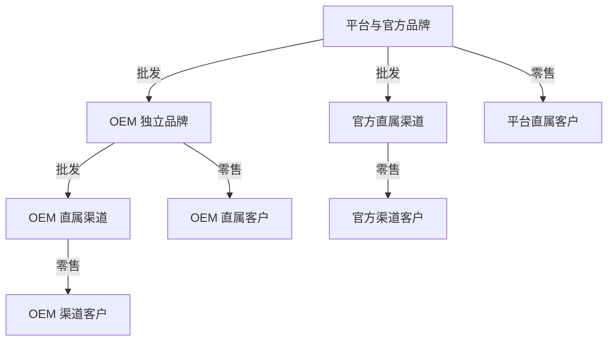

# TokenHub 产品说明书

> 本次接入验收决定（2026-10-16）：用户确认普通线上支付和稳定币材料尚未准备好，授权完成真实驱动、官方沙箱或可复现协议联调、配置预检及明确待配置状态；材料齐全后通过配置启用。当前真实商户未实测必须明示，但不据此阻塞本轮代码交付。此决定覆盖下文将当前真实商户/小额实测作为本轮代码完成前提的默认条款，不允许用接口空壳或固定假支付替代实现。用户还授权将模型、支付等 stateful HTTP 联调服务放在仓库外 `../integration-lab/` 独立部署，业务运行默认不指向 mock。

> 实施状态更新（2026-10-16）：用户已确认产品及方案并授权实施。本轮已核对远程基线，直接在 `release/v0.1.0` 实施。发布约定已于 2026-10-18 更新：release 推送通过 CI 后自动部署该精确 SHA 到测试环境，具体门禁见 README。实际进展见[实施记录](实施记录.md)，规范中的要求不等于已经通过验收。

状态：用户已确认的业务实施基准\
整理日期：2026 年 10 月 16 日\
适用范围：TokenHub 全部已确认产品能力和业务规则

TokenHub 为平台、OEM 和渠道提供独立经营模型服务的系统，为终端客户提供通过一个品牌 API 入口和 API Key 使用多种模型的服务。本说明书是业务重构的已确认基准，配套文档为[关键业务案例与验收标准](TokenHub关键业务案例与验收标准.md)和[一致性检查与决策清单](TokenHub一致性检查与决策清单.md)。

本文归并本次讨论中已经确认的最终规则。后续确认覆盖早期讨论方案，业务与产品重构已获授权。全部已确定功能均在实现范围内，不按“第一版”删减。

## 1 产品定位与实施前提

### 产品目标

- 平台同时经营官方品牌的终端业务和面向 OEM、渠道的批发业务，并提供统一技术能力。
- OEM 和渠道具备套餐、独立定价、营销、客户服务、账务、推广激励等完整经营能力。
- 终端客户购买通用额度套餐，通过 API Key 调用多种公开模型，并用多个 Key 管理不同程序、Agent 或使用者的访问和预算。

各经营方面向自己的客户提供服务、收取款项并承担履约责任。TokenHub 不经营统一交易市场，平台不收取系统服务费。上级与下级的商业关系主要是预付批发采购和后续履约。

### 能力范围

| 使用界面 | 应覆盖的能力 |
| --- | --- |
| 品牌与渠道访问入口 | OEM 定制域名、品牌及渠道网站配色与 Logo、品牌及实际经营方展示、模型与价格、套餐和活动、注册归因、购买与支付 |
| 客户工作台 | 资产及套餐、续费、API Key、用量账单、简单模型体验、异步任务结果、通知与账号处理 |
| 客户推广与佣金页面 | 邀请链接、资格进度、脱敏推广效果、佣金明细；KOL 活动配置及提现 |
| 经营管理后台 | 客户服务、套餐、上架与定价、活动奖励、人员权限、通知、营业状态和经营报表 |
| 资金与权益办理页面 | 收款分配、交付异常、退款冲正、佣金审核和付款登记、开票申请及票据记录、对账 |
| 上下级合作管理 | 主体开通、OEM 与直属渠道个性化配置、供货报价、模型授权、采购、超卖与补货预警、退出及渠道接管 |
| 平台技术管理 | 供应商与密钥、公开模型与能力、Bifrost 路由、计量、健康状态、请求尝试和成本排查 |

页面入口按主体与权限提供，后台界面的存在不扩大上级的数据访问权。客户端体验和运营后台都必须覆盖正常状态、处理中、失败、限制原因及后续可执行操作。

### 界面语言

公开网站、客户工作台和经营管理后台统一支持中文、英语、日语、俄语切换。首次访问依据浏览器语言选择，不支持的语言回落到中文；主动选择后记住当前浏览器、当前品牌域名下的偏好。页头及业务办理弹窗均提供切换入口。

系统导航、表单、校验、状态、业务提示及系统生成的站内通知随界面语言变化，日期和金额显示按语言调整。经营方和客户自行填写的名称、说明、证据、通知正文及模型输出保留原文，不自动翻译。语言切换不改变计费币种、精度、业务时区、周期边界、权限和归属，不清空输入、不重新发起交易；待核实操作继续使用原内容及同一幂等编号。

### 实施约束

沿用现有技术栈、总体架构和 Bifrost 模型路由基座。当前仓库技术参考包括 Next.js 和 React 前端、Go 后端、PostgreSQL、Redis 及 Bifrost；具体版本和模块集成在实施方案中核实。技术选型不构成对现有业务实现正确性的认可。

项目未正式上线。现有数据库表、数据和业务代码均可丢弃或替换，不要求迁移旧数据、兼容旧业务，也不安排新旧业务并行过渡。数据模型、业务模块、接口、权限和页面流程根据本说明书重新设计。

## 2 主体职责与三种业务关系

| 主体 | 经营职责 | 下属经营方 | 技术职责与限制 |
| --- | --- | --- | --- |
| 平台 | 官方品牌零售、向 OEM 和官方渠道批发、自负对应经营责任 | OEM、官方直属渠道 | 统一管理供应商、上游模型、公开模型、路由和计量 |
| OEM | 独立品牌零售、向自己的渠道批发、自主营销与账务 | 自己的直属渠道 | 使用平台技术及授权模型 |
| 渠道 | 在所属品牌内独立收款、销售、营销、服务客户 | 无下级渠道 | 使用品牌授权范围内的模型 |
| 客户 | 购买和使用服务、管理 Key、邀请新客户 | 用户推广下级，不是经营机构 | 以账号为服务单位 |
| KOL | 达到资格的客户，通过邀请关系获得 USD 佣金，可让利推广 | 用户推广下级 | 不成为独立售货经营方 |

三种关系分别记录，不能相互替代：

1. **组织与供货关系**：平台向 OEM 或官方渠道供货，OEM 向自己的渠道供货。
2. **客户服务关系**：每个客户账号归属于唯一经营方，向其购买并由其负责履约。
3. **用户邀请关系**：同一经营方内的用户形成推广链，只向上计算两跳佣金。

四条销售路径为：平台直接零售；平台批发给渠道再零售；平台批发给 OEM 后由 OEM 直接零售；平台批发给 OEM、OEM 再批发给渠道后零售。

OEM 与渠道均为完整经营者；主要组织区别是渠道不能再建立渠道。OEM 是独立品牌，渠道属于平台或 OEM 的品牌体系。

## 3 品牌隔离与客户身份

### 隔离边界

品牌是用户身份隔离边界，经营方是客户、交易、资产和推广关系的归属边界。同一已验证邮箱在同一品牌内只能对应一个客户账号；跨品牌可以分别注册，彼此独立。

同一客户账号不能购买同品牌其他渠道或品牌直属经营方的套餐。需要在同品牌的不同渠道分别购买服务时，必须以不同身份分别注册账号。跨品牌也使用独立账号、套餐、余额和 Key。

套餐、ATG、USD 支付余额、佣金和 API Key 均不跨经营方通用；不开放跨经营方推广。品牌接管渠道是另行规定的整体承接流程。

### 注册归因

| 注册入口 | 客户经营方归属 | 用户邀请关系 |
| --- | --- | --- |
| 有效用户邀请码或邀请链接 | 邀请人的经营方 | 记录该用户为直接邀请人 |
| 有效渠道邀请码或邀请链接 | 对应渠道 | 渠道直属客户，没有用户邀请人 |
| 无邀请码，通过品牌域名注册 | 品牌方直属 | 没有用户邀请人 |

每个正式客户自动获得自己的邀请链接和邀请码。渠道有自己的入口及渠道邀请码；品牌通过域名识别，无须品牌邀请码。

注册页面在最终提交前展示品牌、经营方及邀请关系。链接可以预填代码，用户显式修改后的有效选择为准；旧缓存或旧推广参数不能覆盖最终确认结果。无效、停用或其他品牌的代码必须明确提示，允许更正或显式移除，不能静默改为品牌直属。

完成邮箱验证及正式注册后，才建立客户归属、邀请关系和适用的注册奖励。未完成、失败或重复注册不重复发奖。邀请人的普通用户或 KOL 状态，以被邀请人正式注册时为准，决定该次邀请人 ATG 奖励。

已有账号打开其他邀请链接不改变归属或邀请人。邮箱修改和账号找回保留原账号、购买历史、活动次数及推广关系。普通资料编辑不提供修改经营方或邀请人的功能。

## 4 经营方开通与营业状态

上级创建合作主体并开通首位负责人。平台可以创建 OEM 或官方渠道，OEM 可以创建自己的渠道。可以填写登录邮箱和初始密码后手动交付，首次登录须修改密码；也可通过邮件邀请。邮箱已有经营人员账号时只发放加入邀请，不修改其原密码，须由本人接受。负责人在本经营方空间完成人员、经营和收款配置。登录按账号凭据自动识别空间，仅同时具备两种有效身份时选择本次业务空间。

创建时确定品牌归属和供货关系；跨品牌或更换供货方不作为普通资料修改，需要处理合作关系与存量责任。

平台官方品牌和各 OEM 配置品牌名称、域名和展示信息。品牌 API 入口由有效品牌域名自动生成，不要求另行填写；OEM 域名须完成归属和 TLS 验证并启用，未完成时明确显示入口待接入。渠道在所属品牌内有专属访问入口，展示自身商品、活动、客服及实际收款主体，并共用品牌 API 入口。

### 品牌与渠道个性化

平台可以为 OEM 定制域名、网站配色和 Logo。OEM 网站按对应品牌的配置展示；定制域名完成接入验证后启用，同一域名不能同时绑定不同品牌，避免客户进入错误的品牌空间。

渠道的直属上级可以为渠道定制网站配色和 Logo：平台配置官方直属渠道，OEM 配置自己的直属渠道。渠道个性化应用于该渠道的专属访问入口及客户页面；未单独配置的配色或 Logo 沿用所属品牌的默认配置，已单独配置的项目优先使用渠道配置。

渠道定制外观后仍属于原品牌，共用品牌 API 入口，并保持实际经营方和收款主体清晰可辨。域名或外观配置的变更不创建新品牌、不迁移客户，不改变已有账号、套餐、额度、API Key、邀请关系或分佣规则。

个性化管理按目标主体和人员权限提供，保留配置变更记录。上级拥有定制能力，不因此取得下级资金操作或详细客户账务权限；不同 OEM、渠道的配置不能相互覆盖。

### 业务开放与暂停

配置可以保存草稿。开放相应业务前检查必要条件：模型调用需要授权、有效价格、合格路由和采购余额；套餐销售需要有效商品、可用收款方式和销售承载能力；推广需要有效规则和赠送履约能力；提现需要已公布规则和实际办理方式。缺少某一种支付方式不阻塞其他已就绪方式。

新增注册、新购、续费、模型使用和活动参与分别控制。暂停新增业务不消除存量履约责任；退款、佣金结清、账单查询等存量事项继续办理。采购不足或技术障碍影响实际调用时，按对应责任与通知规则处理。

正式终止经营之前，必须完成存量责任处理或渠道接管，保留历史记录。

## 5 USD 与 ATG 资产体系

| 资产或数值 | 单位 | 用途 | 关键限制 |
| --- | --- | --- | --- |
| USD 支付余额 | USD | 实际资金充值、购买套餐、续费 | 只承载实际资金；未使用且未占用部分可申请退回 |
| 用户服务额度 | ATG | 模型调用 | 来源区分购买和赠送；受有效期约束；不作普通现金兑换 |
| 佣金钱包 | USD | 佣金累计、购买套餐、提现 | 冻结与可用分开；占用与待抵扣独立记录 |
| 采购余额 | 采购 ATG | 向直接上级支付模型调用采购费用 | 不过期，按本供货关系使用，不是客户服务额度库存的一比一映射 |
| 原币收付记录 | 实际币种或稳定币 | 记录外部执行结果及对账 | 不替代 USD 业务账本，不构成锁汇承诺 |

USD 与 ATG 的 1 比 1 是基础计价理解，不是永久兑换承诺。采购优惠、套餐优惠、赠送及不同层级模型报价都会改变实际购买力。

同一调用可以分别消耗客户 10 ATG、渠道采购余额 6 ATG、OEM 采购余额 4 ATG，平台另付供应商实际 USD 成本。每层价格、资产和责任独立核算。

同一经营方内也不提供用户间余额转账、佣金转赠、套餐过户、ATG 转移、账号合并或过户。多个 Key 共享本账号额度，不建立独立资产所有权。经营方定向赠送、错误记账冲正和渠道整体接管使用各自的业务流程。

## 6 公开模型授权与定价

### 模型目录及授权

平台维护供应商、上游模型、公开模型、能力说明、计量单位和路由。OEM、渠道不能自带供应商密钥，也不能新建公开模型。

平台授权给 OEM 和官方渠道；OEM 只能将已获授权模型继续授权给自己的渠道，并可撤销；渠道在已授权范围内决定上下架。平台全局停用模型后，所有品牌都不能继续受理该模型的新请求。

公开模型目录展示标识、能力、输入输出类型、参数、限制、调用模式、计量单位、价格、状态及计划变更。客户可见和可调用范围同时受经营方上架及 Key 模型限制约束。

### 配置职责与计量模板（2026-10-22 确认）

公开模型页只负责公开模型标识、支持的能力及启停。客户请求和页面都使用这个标识。供应商页管理连接、密钥、供应商模型及其参考成本模型。路由页把公开模型绑定到多个供应商模型，并选择按列表顺序优先、最低延迟或预估最低成本策略。线路顺序用上下移动调整；故障暂停与恢复由系统统一处理，不要求逐条填写熔断或额外并发参数。经营人员不填写用量字段路径、供应商计价公式或单独的调用端点路径。

每项公开能力使用一套对外计量口径，输入和输出分别配置。文本可按 Token 或正文字符计量；图片可按 Token、张数或百万像素计量；音频、视频可按 Token 或秒数计量。输入或输出可以不单独收费，但不能两个方向都没有计费项目。向量生成仅对输入计费。图片百万像素按原始提交或实际输出的宽 × 高 ÷ 1,000,000 累加；媒体秒数保留小数，不按单次请求进位到整分；字符按正文 Unicode 字符数计量，包含空格和标点，排除声音选择、控制参数等元数据。

同一方向有两种互斥配置：按全部模态的总 Token 计量，或者按文本、图片、音频、视频分别选择一个计量项目。不得把包含媒体的总 Token 作为文本 Token，再叠加该媒体的图片或秒数费用；不得对同一种模态重复配置两种计量。输入视频不自动拆出帧或音轨另收费。图片输入按实际提交媒体计量，输出按实际交付的结果计量；语音转写优先采用确认的实际处理时长。图片或视频输出可使用明确的规格档位，按系统可识别的尺寸、质量选择，不填写判断公式。

例如，图文理解可选择“全部输入 Token＋输出 Token”；有可靠模态拆分时，也可选择“文本输入 Token＋输入图片百万像素＋文本输出 Token”。语音转写可选择“音频输入秒数”，也可明确增加输出文本项目；语音合成可只按输入正文字符收费，不必再收取输出音频费用。

输入 Token 项目自动区分普通输入与缓存读取，缓存写入归普通输入，同一 Token 不重复扣费。分模态计价同样要求缓存能够可靠归属。只有总 Token、缺少所需拆分的供应商模型，应配置总 Token 口径；运行时不能擅自从已公布的分模态价目切换为另一种收费方式。用量不可靠时按请求核实、超时不收费与停止相应服务范围的规则处理。

系统通过 Bifrost 的标准结构、内置协议适配以及可验证的文件元数据提取数量，不通过运营人员配置的任意字段路径或递归猜测同名字段提取。请求参数可用于预估，但 SDK 从请求回填的数量不能当成实际输出用量。流式与异步请求适用同一计量合同，保留数量证据，不长期保存输入输出内容。

### 上游成本与参考价目

供应商 USD 成本与客户、下级经营方的 ATG 价目相互独立。优先使用已明确币种和语义、可可靠确认的供应商 USD 费用；否则由 Bifrost 根据已确认的上游用量及受理时固定的参考价目计算，保存成本来源和参考版本。缺少成本不等于成本为零，也不影响已经正确完成的客户结算。

平台提供 Bifrost 设置页，展示集成版本、同步状态和最近成功、失败信息，固定每 24 小时自动同步官方参考价目，也可立即发起手动同步；不提供来源地址、同步开关或周期配置。同步失败保留上次成功的数据，不阻塞收款、续费等其他后台任务。受理请求已保存的计价快照不随新价目改变。仅升级 Bifrost 依赖版本不等于已经配置了定时同步。

平台可登记某供应商、可选供应商模型、统计期间的实际 USD 成本和备注，页面展示同范围的系统核算额、登记额、差额及缺少核算成本的调用数。该功能只做登记对比，不增加采购折扣、分析归因、账单审批或自动调价流程，也不重算已正确结算的客户账单。

### 多层价格

采购额度的购买报价与模型调用价目分别管理。平台维护自己的官方零售价及批发价；OEM 分别管理直属零售价和对渠道批发价；渠道管理零售价。供货方可以对不同买方采用不同采购报价和调用价目。

批发和零售均采用请求受理并预占时生效的价格。一经受理，本次请求全程保存对应计价快照，流式、跨期和异步请求也不因途中调价改变价格。采购批次不锁定未来模型调用价。

每次调价通知受影响方，重算购买力、销售承载能力和经营风险。已持有 ATG 数量和历史扣费不因调价重写。

经营方支持手动定价和自动跟随上级调用价，自动跟随可采用默认倍率及模型级覆盖。OEM 的零售价和渠道批发价分别配置。倍率是定价参数，不是实际利润率。

限时模型促销价独立于常规价管理；结束后恢复当时应生效的常规价。正常价格与模型变更提前通知，紧急事件可立即停用并通知。尽可能保护已受理请求；不能完成时按请求失败和异常履约规则处理。不得自动替换用户指定的公开模型。

## 7 Bifrost 路由与请求交付

Bifrost 是既定模型路由技术基座。平台在现有架构内实现并验收本文约定的路由行为，不预设所有能力均由当前 Bifrost 版本原生提供。

同一公开模型可以关联多个经核实的上游。选路必须匹配模型身份及请求所需能力，包括输入类型、工具调用、上下文和输出约束。不能静默忽略参数、丢弃图片、截断输入或降低能力；用户明确允许的处理方式除外。

平台统一管理优先级、容量、健康、延迟、成本和故障切换策略。异常路由可自动停用，经验证后恢复。底层路由变化不改变已受理请求的公开模型和各层计价快照。

尚未交付结果时，可以在安全条件下重试同一公开模型的合格上游；流式输出已经开始后，不自动重新生成并拼接新结果。异步提交结果不明时先核实原任务，仅在有可靠幂等保证或确认未创建时重新提交。

一次客户请求有稳定编号，内部尝试关联其下。内部重试不重复扣减客户及采购层余额。额外上游尝试成本、平台计量或采购预占上界错误造成的成本，由平台按技术责任记录承担。

## 8 批发采购与成本

### 采购交付

所有经营链条先付全款后获得额度。线上支付或线下资金到账均需核实；无采购授信，不允许欠款调用。

采购余额不过期，固定每 1 USD 购买 1 ATG。供货方按直属采购方发布阶梯赠送报价，只配置各金额区间的赠送百分比。赠送按每笔订单金额分段累加，不是整单套用最高比例，也不跨订单累计。例如 0–1000 USD 赠送 0%、1000–2000 USD 赠送 1%、2000 USD 以上赠送 2%，采购 2000 USD 得到购买 2000 ATG、赠送 10 ATG；采购 2500 USD 得到购买 2500 ATG、赠送 20 ATG。采购赠送不参与客户 KOL 分佣。

采购方可任意填写采购金额，系统在付款前展示购买、赠送与总额度。每单只有一笔线上付款或一笔线下付款，不拼接多笔收款，也不把一笔收款拆给多个采购订单。核实整笔足额付款后自动交付；金额不足、超额、重复等异常另行处理，不先交付部分额度。线下已核实到账后，供货方也可选择整笔收款并关联报价，系统按该笔 USD 金额自动创建订单、计算额度并交付。

每笔采购记录实付 USD、购买与赠送采购 ATG、供货关系、报价版本及阶梯计算快照。低于最小记账单位的赠送尾数保留在计算凭据中，购买前展示并确认实际发放的精确数量。

采购订单固定本次购买报价及事先约定的退出退款条款，未来模型调用价继续浮动。采购来源需要可追溯，单笔采购的购买和赠送部分按比例消耗；此记录用于退款和权益归属，不形成批次锁价。

### 移动加权平均成本

经营方每次采购入账后，按剩余采购成本加本次实际采购成本，除以剩余采购额度加本次全部交付额度，得到新的平均单位成本。采购赠送增加数量，不虚增现金成本。

每次调用结算保存本次实际采购扣量、适用的平均成本及成本结果。之后补货、调价或退款不重算已完成调用成本。平台记录供应商实际成本及内部失败尝试成本。

采购退款、接管抵扣的合同现金价值，与账面平均成本分别记录。移出采购额度时相应转出账面成本，差额单独调整，不能留下负数库存成本或把历史调用成本改掉。

## 9 销售承载能力与超卖额度

### 超卖的含义

品牌方为自己的渠道设置**超卖额度**。额度为零时，出售前须有足够采购储备覆盖承诺；为正时，允许在限定范围内提前出售更多服务权益，用于营销高峰中的补货缓冲。

超卖额度只影响能否增加销售承诺，不增加实际采购余额。调用时采购余额不足就停止服务，由经营方补货并承担责任。OEM 自行决定其超卖安排；平台不向 OEM 提供采购授信。

### 覆盖计算

销售覆盖按所有已开放模型及计价组成中，单位客户额度对应的最大采购成本计算，不使用平均历史模型组合。必须覆盖有效的购买与赠送客户额度，以及已占用的待付款交付承诺。

单一供货关系下的核算思路为：

> 可新增承诺能力 = 未被调用预占的采购余额 + 超卖额度 − 有效且未被调用预占的客户权益所需最大采购额 − 待成交订单承诺。

已经被调用预占的客户额度和采购余额分别排除，避免重复占用。预占上界自身仍必须由真实采购余额覆盖。

USD 支付余额与佣金是现金责任，不计作可调用 ATG，也不能直接充当采购余额。OEM 对上游的责任汇总包括自身直属客户权益和对渠道尚需履约的采购余额，不能再把渠道全部终端客户额度重复相加。

新购、续费、活动赠送和定向赠送均检查并占用销售承载能力。待付款订单占用到有效期，成功转成交付责任，失败或关闭释放。收到钱但交付失败须继续处理原订单，不能直接释放责任后遗忘付款。

调价、新增或移除模型、销售、消耗、到期、补货、退款等事件触发重算。发生覆盖缺口时保留已售权益，按范围停止增加承诺并告警，不通过清除客户余额恢复指标。

### 预警与补货

在进入超卖范围之前就发出预警。分别展示正常销售空间、超卖使用量、补货预计需求、接近上限、售空及实际调用余额不足，不能只在已超卖或停服后通知。

支持阈值、负责人、提醒间隔、升级和恢复通知。上级按合作权限查看渠道汇总风险，敦促补货。

支持手动补货和明确授权的自动补货。自动补货固定触发条件、每次采购 USD 金额、适用报价授权、单次及周期上限，并防止同一采购账户重复发起未完成的自动补货。付款或收款未确认前不加采购余额；失败通知并按规则处理，不能先提供授信。离线方式支持提醒和人工确认到账。

每段供货关系独立补货。渠道向 OEM 付款，不等于 OEM 已向平台补足采购资金。自动补货也不能静默接受授权范围外变差的采购报价。

### 商品与定价的日常操作（2026-10-23 收敛）

模型定价按公开模型组织，集中展示计费模板、本经营方的客户零售价、对各直属下级的供货价及待生效变更。未上架的已授权模型也能先完成计费与定价准备。供应商成本仍独立核算，不成为对外定价必须逐项照搬的规则。

每项调用能力分别配置输入、输出：每个方向选择不计费、统一 Token 或按模态组合。文本支持 Token、字符；图片支持 Token、张、百万像素；音频与视频支持 Token、秒。统一 Token 与同方向的分模态计费互斥，缓存读取单列、缓存写入归普通输入。尺寸和质量仅在确有差异价格时选填。

经营方只需选择模型、定价对象和 ATG 单价，或选择跟随上级供货价的倍率。上级供货关系由系统识别，指定模型的独立价格优先于全模型默认跟随规则。常规定价无需填写版本编号、通知引用、通知依据或生效时间；每一范围内新模型首次定价直接发布，已有价格的调整由系统生成版本、通知并安排生效。限时价格保留真正有业务含义的起止时间。通知任务延迟时，自动安排的变更顺延生效，原价继续有效，不要求经营方重新填写手续。切换已启用模型的模板时，可以提前准备新模板的单价和尺寸档位；旧模板使用期间保留对应计价项目，模板正式切换后只按新模板计费，不重复扣费，也不因准备尺寸价格而使待生效模板版本冲突。

## 10 通用额度套餐与到期

套餐只售卖给本经营方直属客户。平台、OEM、渠道分别管理自己的套餐。

仅支持通用 ATG 套餐，不建立特定模型专用套餐。额度可用于当前经营方已授权并上架的模型。新增模型可供已有通用额度使用，并触发覆盖重算；单个模型下架不直接导致通用套餐普通退款，整体无法履约另走异常处理。

套餐包含：最终应付 USD 售价、购买 ATG、赠送 ATG、有效期类型、续费安排和必要销售条件。购买 ATG 与实际 USD 无须固定 1 比 1。

| 有效期 | 使用期限 | 续费 |
| --- | --- | --- |
| 不限时 | 不过期 | 不自动续费 |
| 月 | 从本次生效时间起一个日历月 | 按用户授权执行 |
| 季 | 从本次生效时间起三个日历月 | 按用户授权执行 |
| 年 | 从本次生效时间起十二个日历月 | 按用户授权执行 |

月末无对应日期时取目标月末。套餐在足额付款并成功交付后生效，展示明确起止时间。多份套餐、重复购买可以并存并分别生效。周期内提前用完不自动提前续费或重置周期，客户可额外购买。

经营方创建或编辑套餐只填写名称、售价、购买与赠送额度、有效期，分别控制是否允许新购、是否允许客户授权续费。不限期套餐不显示续费开关。补充服务说明选填，固定产品规则由系统提供，编号与时区无需逐单配置；编辑旧套餐保留其原时区。停止新购和停止续费互不代替，已购订单不重算。

套餐自带和随订单活动赠送的额度与该套餐同期限；独立注册、邀请、定向赠送有各自明确期限。到期余量不结转。正常到期不产生普通退款。

先到期的有效额度先使用；同一套餐订单内购买与各来源赠送额度按比例消耗。不限期额度排在有到期时间的可用额度之后。同到期时间采用稳定、可复现的顺序，不能按来源任意改变客户扣减结果。

## 11 套餐支付与自动续费

支持直接在线购买、线下款项确认购买、USD 支付余额购买，以及可用佣金购买。客户不必先充值支付钱包。支持明确展示来源的组合支付；需足额资金和销售能力同时满足后交付，失败释放内部占用，外部已收款走原订单处理。

自动续费产生新的套餐订单及有效期。使用 USD 支付余额；是否使用可用佣金补足由用户显式选择。冻结佣金不能用于购买或续费。不足时提醒，不负债扣款，不自动延长原套餐；其他仍有效额度可以继续调用。

客户的套餐页面展示当前余量、有效期以及下次续费的价格和额度。不显示不适用的续费控件：不限期套餐无需续费，已到期且从未授权续费的订单通过重新购买补货。余额不足的续费仍保留原授权意愿，可补足资金后继续重试，也可停止。

关闭自动续费保留当前有效套餐。停止新购和停止续费分别管理。经营方停止续费须通知已授权客户。

续费通知与续费授权分别处理：站内通知成功发布后，条件不变或仅改善时可按已有授权续费，不要求客户阅读通知或等待邮件送达。首次从已购订单开启续费也核对当前可续费报价；报价变差须明确确认，过期页面不能静默接受后来发布的新报价。

条件不变或仅改善时，可在通知后按已授权安排续费；USD 涨价、总额度减少、有效期缩短或其他权益减少需要重新确认。即使金额提高同时增加额度，也属于需确认的支付变更；有好有坏的变化同样需确认。未确认则停止相应续费扣款。

一次活动优惠不自动延续至后续订单。续费适用活动时也需符合活动条件和次数限制。模型目录与调用价的变动按其自身通知规则管理，不能把原套餐锁定数量误解为模型购买力永久锁定。

## 12 请求预算预占与实际结算

### 受理与预占

请求受理前检查品牌、账号和 Key 状态、模型授权与能力、预算、频率、并发、客户额度以及各层采购余额，固定价格和受理时间。

客户额度和 Key 预算按合理预估占用；每层采购余额按可约束的最大可能采购费用预占，例如输入规模与最大输出量形成的上界。任何一层失败，释放本次已取得占用，不调用供应商。

无法可靠计量或无法约束采购费用上界的能力，完成必要控制之前不开放。合理估算用于客户体验，不替代采购层“不欠款调用”的硬约束。

### 完成结算

按实际可确认用量与受理时价格结算，释放多余预占。一笔结算关联原请求、各层预占、扣减来源、购赠比例、实付对应金额及成本结果。

实际费用超过 Key 剩余预算，仍扣减本账号可用额度，Key 剩余可用预算显示为零并阻止后续超限请求。预算记录保留真实超额数值，不把实际消费裁剪为上限。

实际费用超过本次客户预占时，可继续使用本账号当时有效且未被其他请求占用的额度。账户不足部分由所属经营方承担，不挪用其他请求占用、不形成客户负余额，也不从以后充值或新购额度补扣。未由客户额度承担的部分不计客户有偿消费和佣金基数。

正常采购扣款不能超过该层已经可靠预占的上界。平台计量或上界控制失误按平台异常成本处理，不转为买方采购负债。

### 取消失败与用量核实

客户取消、断开或中断请求，按已发生且可确认的用量收费。平台或供应商故障导致无可交付结果时不收客户费用；有可交付部分的情形按确认用量和责任记录处理。输出不符合客户主观预期不自动构成计费错误。

用量暂时不能核实的进入有限期待核实状态，保留必要占用；到期限仍无可靠用量则不收费并释放占用，之后收到迟到用量不再追扣客户。对应技术或上游异常成本单独记录，不能通过恢复旧请求扣款绕过该承诺。

持续不可靠的路由须限制或停用并校准。用量核实等待与消费确认、佣金冻结是两个不同阶段，不能混为一个无限期冻结。

## 13 API Key 生命周期与预算

每个账号可创建多个 Key，设置名称和备注。Key 可限定模型或不额外限定模型，配置 ATG 使用预算、请求频率和并发上限。所有 Key 共享账号额度池，不提前划拨 ATG，各 Key 预算总和可以大于账号余额。

预算窗口为不限时、自然月、自然季、自然年。不限时预算从该 Key 创建起累计，不自动重置。自然周期使用明确展示的经营时区；中途创建不按天折减上限。请求始终归受理时所在窗口，即使完成时已跨期。周期变化重置的是窗口可用预算，不是账户资产，也不是密钥到期。

完整密钥只在创建或重置时展示一次，之后显示可识别部分。日志、通知和客服界面不展示完整密钥。重置立即禁止旧密钥受理新请求，保留原配置、当前窗口已用及预占和历史记录；平滑迁移可另建 Key 后停用旧 Key。

停用可以恢复，恢复不清空当前预算记录；删除永久失效但保留必要历史关联。已受理请求按原规则完成或通过单独取消操作处理。删除、停用或重置不免除已发生费用。

调用 Key 只访问授权模型能力和有权限的任务，不赋予购买套餐、提现、修改收款信息、修改安全设置或创建其他 Key 的管理权限。

泄露时客户可停用或重置，经营方和平台按各自安全权限限制异常调用。费用争议依事实和责任处理，通过冲正或补偿保留原始账务。

## 14 邀请奖励与 KOL 资格

### 注册奖励

各经营方设置邀请人与被邀请人的注册 ATG 奖励及有效期。奖励承诺生效前检查并占用履约能力；正式注册成功且满足规则时发放，重复事件保持幂等。已成立的奖励承诺遇到交付故障时保留待处理责任，不能静默取消。

邀请人为普通用户时可获得该次邀请奖励；已经取得 KOL 资格后，邀请新用户不再领取普通邀请人 ATG 奖励，被邀请人仍可获得适用的新客奖励。KOL 功能被暂停不自动退回普通用户奖励模式。

### 资格累计

资格门槛以本账号订单的**已确认真实支出 USD**累计，包含：

1. 已实际消耗的购买额度对应的订单实付金额，经过消费确认期后计入。
2. 到期未使用的购买额度对应的订单实付金额，经过相同确认机制后计入。

赠送额度、尚未用于购买的 USD 余额、有效期内尚未消费的购买额度不计入。到期部分不产生佣金。每个订单计入资格的总额不超过有效实付金额；已消费与到期归属互斥，不重复计算。采购交易不属于终端客户资格消费。

若订单实际支付为 P USD、购买额度为 Qp，购买额度实际消耗 q，则其有偿消费基数为 P × q ÷ Qp。由于订单内购赠按比例使用，也可用实际消耗占订单全部额度的比例核对结果。赠送来源可以不同，但都不单独产生有偿基数。

实付为正的套餐必须包含正的购买额度，以保证上述分摊成立；无实付赠送的有偿基数为零。

### 达标与保护

待确认金额不计门槛。达到门槛后自动取得 KOL 资格；已有下级之后的消费也可带来佣金，不追溯升级前的消费。门槛提高保护既有资格，门槛降低使新达标者同步受益。

消费确认与佣金冻结共用经营方配置的一套确认机制。已产生事件保留适用规则和确认时点，不追溯延长冻结；有争议的金额不能仅因时间经过就自动确认。订单已经固定的分佣条款继续适用。

正常退款和例外账务纠错修正累计金额，但不撤销正式取得的资格。确认作弊可按违规流程暂停或终止分佣功能，不删除资格取得历史。

## 15 两级佣金与佣金钱包

仅向直接邀请人、间接邀请人两跳计算。没有某一跳就不产生该跳佣金；其中谁在消费发生时具备有效分佣资格，谁获得对应份额。不跳过不合资格者向更远上级分配，也不把其份额加给另一跳。

订单购买时固定直接、间接佣金比例和 KOL 让利条款。实际消费结算形成消费事件时判断邀请人的有效资格；规则变化只影响之后的新订单，不改已售订单比例。之后取得资格不追溯已经发生的消费。

佣金仅按实际有偿调用基数计算：

> 直接佣金 = 有偿消费基数 ×（订单直接比例 − 订单让利百分点）。\
> 间接佣金 = 有偿消费基数 × 订单间接比例。

赠送消耗、未消费的有效额度、到期金额及经营方承担的客户额度缺口均不产生佣金。直接资格失效不取消仍有效的间接资格。

佣金先冻结，在对应消费确认后解冻。可用佣金可买套餐或申请提现。佣金购买套餐是有偿支付，但不重复记录为经营方收到新的外部现金。

正确佣金不因事后改价、改规则或经营方善意补偿而追溯变更。基数或资格确实错误的佣金可以冲正：冻结部分撤销，可用部分扣减，不足时记录待抵扣，后续解冻佣金优先抵扣，或由经营方另行处理。不动用用户 USD 支付余额、ATG 或其他正常资产，不拆除已经正常购买的套餐。

## 16 KOL 让利与经营方促销

### KOL 活动

KOL 通过推广活动引用本经营方现有套餐，不建立自己的独立套餐或经营机构。活动只适用于该 KOL 的直接邀请客户，不支持跨 KOL 领取。

KOL 从自己的订单直接佣金比例中让出若干百分点。客户购买时取得额外赠送 ATG，由经营方履约；KOL 在该订单后续有偿消费中少取相应直接佣金，不预先垫付赠送现金成本。

> KOL 额外赠送 ATG = 套餐基础购买与自带赠送 ATG 总量 × 让利百分点。

经营方活动额外赠送、注册赠送和 KOL 自身赠送均不再次放大该基数。让利不能超过适用直接佣金比例；未来规则降低导致活动不再满足条件时停止新的不合规订单，不能改写已成交订单。

活动可设置新客或既有直属客户条件、适用套餐、有效时间、每人次数、同 KOL 跨活动次数和总量限制。不把首单限定写成唯一模式，也不让优惠永久附着邀请关系。同一 KOL 不同活动可在不同订单使用，单笔最多一个 KOL 活动，受全部次数限制；后续新购和续费不自动继承。

### 经营方活动与组合

经营方活动引用现有套餐，支持降低本次 USD 售价、额外赠送 ATG，或二者组合。实际支付下降后，有偿基数也按本次实际支付计算；优惠额可以统计，但不在已经降低收入后再重复扣作成本。

一笔订单最多一个经营方套餐活动和一个 KOL 活动。两类默认不并用，经营方明确开放指定组合后才能一起使用。购买页面展示最终价格、基础额度、各类加赠及适用条件。

活动次数、预算与履约能力在待成交时占用，成功后核销，失败或关闭释放；重试和重复付款通知不能多送或多占次数。同订单活动赠送与套餐同期限并按比例消耗。

## 17 到期冲正退款与补偿

### 到期与在途请求

到期时，未被请求占用的余量失效。到期前已受理请求的有效预占可以在规定执行或核实期限内用于该请求，不能再次供其他请求使用。到期后释放的未用预占转为到期余额，不恢复为可用余额。

请求超出预占的费用只能使用当前仍有效且未占用额度，其余由经营方承担。到期购买额度对应的资格累计须在相关在途请求解决后准确归类，再经过确认，防止一份额度同时计入消费与到期。

到期减少服务责任，不增加采购余额。未消耗的赠送不是已经发生的履约成本。

### 退款范围

套餐不支持一般性退款，包括未使用、部分使用、已到期和不限期套餐；可以停止未来续费。重复或错误交易、未正确交付及无法履约等另按异常流程办理。

未用于购买且未占用的 USD 支付余额可申请退回，由承担该客户责任的经营方办理。申请先占用退款金额，实际退款核实后结清；批准不等于已退款，失败或取消释放，付款结果不明时保持待核实状态。

无法履约时，按对应未履约购买额度的原实付价值处理，不通过重新定价已正确消费部分追回原套餐优惠。关联剩余赠送一并处理，正确消费及其正确佣金不自动撤销。未解决的履约事件不能因套餐在处理期间到期而消失。

### 错误扣费

错误扣费通过新冲正记录关联原账，修正相应有偿基数、佣金、成本与资格记录，不能删除原账。恢复购赠比例及原订单规则。

仍在有效期内的额度恢复原有可用权益；原额度已到期的，仅纠正账务并转入正确的到期归类，不延长有效期，不新建“纠错补用期”。已到期购买额度的资格归属重新核对，避免消费与到期重复计入。

额外补偿由经营方决定，可以道歉、定向赠送 ATG 或提供促销优惠。补偿赠送保留独立来源及有效期，不产生有偿消费或佣金基数，不改写原正常交易。

### 退款资金来源

直接在线支付按原通道处理，支付余额支付先恢复对应 USD 余额，佣金支付恢复佣金并遵循待抵扣安排；组合支付按原来源分摊，线下退款核实实际支付后登记。同一来源累计退回不超过其实际可退金额，不重复退回。

原收款主体、原付款来源、责任承接记录必须可追踪。原路受到通道限制时进入异常结算，不能把未完成退款记为已完成。

## 18 佣金提现

提现申请立即占用可用佣金，固定申请 USD 金额、适用费用和 USD 净应付。冻结佣金和已占用金额不能重复使用。可配置办理方式、最低金额、费用与处理安排，并在申请前展示。

经营方审核并在线下实际打款，系统不代发佣金转账。核实实际付款后扣账，保存收款信息、时间、凭据和处理人。审核通过不等于付款成功。

审核前可按流程取消；进入付款环节后必须先核实是否已经支付。取消或明确失败后释放占用，结果不明保持待核实，避免重复打款。失败或取消不收成功提现费用，相应已发生通道成本由经营方处理。

提现费用可固定金额或按比例配置，但申请时固定。佣金直接购买套餐不属于提现，不收提现费用。可用金额不足以支持申请及费用时不能提交超额申请。

## 19 收款订单交付与外部代付

### 三类记录

收款记录说明钱是否实际收到；订单说明成交条件和金额；交付记录说明资产是否成功发放。三者分别跟踪、相互关联，不能仅凭支付页面跳转就发放权益。

订单至少能区分待付款、部分付款、足额付款待交付、已完成、关闭及异常处理。线上支付以核实的通道成功结果为依据；线下支付由有权限人员核实真实到账，截图本身不作为到账事实。支付成功与通道向经营方结算的时间分别记录。

支持多次付款补足一个订单，也支持一笔经核实的线下款项分配给同一经营方多个订单。分配总额不得超过真实收款，不跨收款经营方混用资金。

超额或暂时无法匹配的款项单独待处理，经确认用于其他订单、USD 充值或退款，不静默转为赠送或另一商品。迟到通知与实际迟到付款分开：以真实付款时间判断原订单是否有效，订单过期后实际付款的，进入异常处理，不静默按更差条件成交。

订单关闭及释放销售占用前核对付款状态。重复通知、人工确认和交付重试必须幂等。已足额付款但交付失败时处理原订单，不能要求重复支付；无法履约时办理异常退款。

### 代付

允许有效外部代付。权益归订单账号，实际付款人和来源另行记录；付款人不自动获得账号、Key 或资产管理权限，不改变客户经营方或邀请关系。

资格累计按订单账号的已确认实付支出归属，不要求资金必须来自账号持有人自己的付款工具，也不同时计入付款人其他账号。相同付款来源本身不直接判定作弊。

退款遵循原支付来源；使用支付余额购买的先恢复该余额，之后退回余额继续追溯原充值来源。一次代付不授权对付款人进行后续扣款。代付争议按相关资金来源限定影响范围。

## 20 稳定币外币与费用

### 外部换汇

业务确定 USD 应收应付金额，外部银行或支付渠道处理换汇。系统记录实际原币或稳定币种类、网络、数量、USD 对应金额、执行时间和可验证依据，不锁汇。

历史汇率用于追溯，不承诺未来按原汇率退款。提现申请固定 USD 费用及 USD 净应付，其他币种显示仅作参考，以实际执行结果登记。收款时未发生真实换汇的，也需可核实的当时外部估值依据，不能任意创造入账价值。

原路退款受原币种、金额或通道规则约束而不能完成 USD 应付款时，进入异常结算；差额仍可追踪，不能假报结清。

### 稳定币收款

同时支持第三方稳定币通道和经营方自有钱包收款，用于客户支付余额充值、套餐购买和批发采购。稳定币接入对象包括 USDT、USDC 等；平台维护实际支持的币种与网络组合，经营方选择启用并配置自己的收款账户或地址。具体通道和网络属于接入清单，不默认所有币种和网络均可用。

各经营方独立收款，平台不集中代收下级款项。自有钱包私钥由经营方保管，系统负责识别、核实、订单关联和记账，不托管私钥或代签转账。

核验资产、网络、收款地址、到账数量和所需确认状态；交易哈希或截图仅作为查找线索。少付、多付、迟付、错币、错网和无法识别支付进入异常处理，同一真实收款只能分配一次。

不把稳定币名称直接等同永久 1 USD。按实际执行或可验证估值核实 USD 金额；确认后的客户 USD 余额不随经营方持有稳定币的后续价格波动重估。

通道退款按其可用能力办理，自有钱包退款由经营方外部执行后登记。收款地址和网络需核实，不能盲目把链上发送地址当作退款地址。稳定币充值可支持后续余额续费，不产生对外部钱包的自动扣款授权。

### 费用归属

商户侧收款和退款费用由相应经营方承担，客户权益按订单金额交付。付款人自身的钱包发送、网络或交易所提现费用由付款人承担，并保证满足订单应收要求。

例如客户应付 100 USD、商户侧费用 3 USD，客户仍取得 100 USD 对应权益，经营方记录 97 USD 实收净额与 3 USD 费用。费用只记录一次，充值后消费余额不再虚增一次支付费用。

佣金提现费用依申请时固定规则处理；换汇或通道差额单独对账，不能未经核实统称手续费或直接修改客户余额。

## 21 外部支付争议与扣回

外部支付成功后仍可能发生争议与扣回。消费确认期是内部结算安排，不是对外部付款绝不会撤销的保证。可参阅 [Stripe 的支付争议机制说明](https://docs.stripe.com/disputes/how-disputes-work)；具体外部处理以实际接入通道为准。

争议独立记录原收款、关联订单、金额、通道扣款及费用、证据、处理期限和结果。通道扣回款项与业务确认付款无效分别记录；争议通知不直接等于用户作弊。

在所涉范围内，暂时限制相关且仍可控制的支付余额、套餐额度及佣金使用或提现。不牵连其他正常来源资产；部分争议按部分处理。核实正常后解除，原记录保留。

| 核实原因 | 权益与账务处理 |
| --- | --- |
| 付款无效、盗用支付工具或重复入账 | 撤销对应未使用权益和关联剩余赠送，冲正错误佣金及资格累计；已消耗服务保留，损失单列 |
| 经营方无法履约而退回 | 按异常退款办理，保留正确消费和正确佣金 |
| 客户付款有效，仅商户账户冻结或结算延迟 | 客户权益继续有效，由经营方处理周转与通道问题 |

错误佣金不足时仍走待抵扣机制，不动用其他正常资产；资格累计回退不自动撤销正式 KOL，作弊另按违规处理。

实际收款经营方承担收款费用和无法追回损失，追回后再补记。客户付款被扣回不自动撤销已正确完成的上游采购结算，也不取消其他客户权益。

任何退款前核对争议、扣回及既有退款，通道已经退回的部分不得再支付。后续通道返款追加记录，并核对之前的权益处理结果。

## 22 采购退出与渠道接管

### 采购余额退出

采购余额不支持日常自由退款。主动退出时是否退回、退回方法和范围由采购报价事先明确；供货方不能履约走异常退款。采购赠送不作现金退回。

可退购买部分按原实付金额和未使用购买部分比例计算，不按当时模型价或 ATG 名义 1 比 1 兑换，也不追溯重定价已经正确消费的服务。

终止合作必须处理有效客户权益、USD 支付余额、佣金、下级采购责任及自身上级采购余额。可以协调分阶段处理，不要求在一切资产都无法变现时先垫清全部客户再受理上游结算，但不能消除对客户的责任。

### 渠道整体接管

平台不自动接管独立 OEM 的客户。品牌方可依事先约定的授权和触发规则，或明确接管决定，整体接管本品牌渠道。短暂采购不足本身不等于自动接管。

接管完整保留客户账号、Key、有效额度及购赠来源和期限、USD 余额、冻结和可用佣金、待提现与待抵扣、推广链、KOL 状态、预算及历史记录。品牌 API 入口和账号连续使用。原渠道历史交易保留归属，并新增接管记录。

品牌方承担接管后的履约与客户资金责任。旧订单继续适用原已锁定条款，新订单按品牌方当时规则执行。正常客户权益不因渠道与品牌间资金缺口受损。

### 一次性作价与抵扣

服务权益按事先约定的方法一次性作价承接，可采用交接时适用的供货成本覆盖口径，并保留完整明细。原渠道采购余额优先抵扣服务承接金额，包括可用于履约的采购赠送；这是交接作价，不伪造为实际模型消费。

服务责任抵扣后的剩余采购余额中，合同允许退回的购买部分，按其可退 USD 价值继续用于双方现金结算；赠送及不可退部分不能直接按面值变为现金。

现金责任包括客户 USD 余额、已产生冻结和可用佣金及未完成支付，注意占用子项不重复相加。旧订单将来的佣金由品牌方履约，可单独估计风险；任何额外交接价款需事先约定。

作价完成后，未来实际消耗、到期、调价带来的收益与风险归品牌方，不再与原渠道逐笔分成或追补。资金缺口由双方另行结清，不影响客户权益。接管抵扣不自动为品牌方补足自己的上游采购余额。

## 23 人员权限与风险处理

### 经营权限

各经营方独立配置人员及角色，可组合或细化负责人、运营、财务、客服和只读权限。终端客户仍为账号，不由此引入客户团队组织体系。

上级默认只有合作、授权、报价、超卖、按第 4 章范围提供的个性化配置及约定范围内的风险汇总权限，不自动获得下级客户详细账务、资金操作、套餐编辑或内容访问权限。平台的供应商和路由技术权限与经营财务权限分开。

资金和权益操作保留处理人、原因、关联记录及必要凭据。通过业务动作记账，不直接编辑余额。复核可按事项和金额配置；启用独立复核时，发起人不能冒充另一人审批，单人经营场景不强制两人参与。

### 可疑与违规

按影响范围限制调用、活动、佣金或敏感操作，保留原因、状态、复核期限和用户说明入口。超期提醒并升级，不能长期无人处理。

可疑阶段相关佣金继续按原规则计算、记录，暂缓释放和使用，核实正常后恢复。IP、设备或付款来源相同只能作为线索，不单独认定作弊；允许的不同身份注册也不自动构成违规。

确认作弊后按来源撤销尚未使用的违规奖励，冲正错误佣金；已消耗违规赠送记录损失及后续处理，不自动扣取其他正常资产。正常购买、正常佣金和其他客户合法权益保留。

KOL 资格取得记录与功能状态分开。可因确认作弊暂停或终止推广和分佣，明确生效时间；之后不再产生该人的佣金，也不转给其他人。之前正确佣金仍结清，错误部分才冲正；不退回普通邀请人 ATG 奖励模式，推广链及其他合资格上级分佣保留。

## 24 停止使用注销与资产处理

停止使用可以关闭续费、停用 Key，账号及资产继续保留。套餐按原期限变化，推广和佣金仍按规则产生；不登录本身不撤销 KOL 资格。

正式注销需要明确展示并处理：在途请求、待核实扣费、USD 退款、已产生及冻结佣金、提现、待抵扣和未完成争议。套餐不因注销获得普通退款权，客户可使用后注销或明确放弃剩余额度；赠送在正式注销后失效。

注销流程明确通知并记录停止产生未来佣金的时点，经客户确认后生效；之前已产生金额继续结清。关闭续费、Key、新活动和邀请入口。未结事项存在时处于注销处理中，保留查询及结算所需入口，不能直接清空现金资产。

已有下级仍属原经营方，推广链保留，不跳级或改挂。注销者停止分佣后，仍合资格的另一跳继续按原关系分佣。已有客户套餐及活动赠送不因其邀请人注销而撤销。

保留必要账务与关系记录。注销和再注册不重置新客资格或活动次数，不能用于更换渠道。无法单独支付的小额尾数须明确约定处理，点击注销不等于放弃。

## 25 API 网页体验与数据留存

按品牌提供统一 Base URL，渠道共用该品牌入口，Key 决定实际经营方和权益。跨品牌隔离。支持模型能力允许的同步、流式和异步调用。

请求及任务具有稳定编号。支持幂等标识，同范围相同标识和相同内容返回原处理结果；相同标识但内容不同明确报错。查询任务状态、重复取得同一结果不新增模型调用费；客户明确发起新任务才形成新的请求。

网页提供简单体验，与 API 共用账号额度、模型价格、计费及记录；免费体验通过明确赠送 ATG 实现。

不提供长期请求内容保存、长期会话历史，也不提供用户主动开启该功能的开关。网页仅保留体验所需的当前上下文。异步结果按提前展示的期限暂存，供客户获取下载后按期清理。

保留必要账务元数据，包括请求编号、模型、计价快照、用量、额度来源、金额、成本和纠错关联；技术记录脱敏且有保留期限，不长期保存完整内容或密钥。故障排查需要内容时，通过用户提供或明确范围和期限的临时授权处理。

访问遵循权限并留痕；必要的未结争议证据按处理需要保留。内容删除或结果暂存到期不撤销正确费用。账务与技术数据的具体期限在实施配置中明确展示。

## 26 通知预警与明确授权

站内通知保留完整内容，重要事项同时发送验证邮箱。资金、资产、安全、履约及重要规则变更属于必要业务通知；营销活动可退订。普通使用提醒可调整阈值或关闭邮件，站内仍可查询。

覆盖收款交付、退款提现、冲正、价格与模型变化、续费条件及失败、到期、Key 预算、采购储备、超卖、补货失败、风险限制和接管。API 拒绝同时返回明确机器可读原因及可理解提示。

发送、送达、阅读、明确确认分别记录。需要重新授权的条件必须展示具体变化与版本，沉默或未读不能视为同意；后续出现新的不利变化再次确认。

正常变更在满足事先公布的提前期和渠道规则后按计划生效，紧急停用立即执行并通知。发送失败重试、持续失败跟进，失败不记为送达；单封邮件失败不无限期阻塞不要求重新授权的正常业务。

经营预警分级，重复事项按间隔提醒，升级立即通知，恢复发送恢复通知。经营方配置负责人和接收人，上级仅收约定权限内的合作风险信息。

## 27 账单经营报表与对账

### 客户视图

客户可查 USD 收支与占用、套餐购赠及到期、按请求模型和 Key 的消费、佣金各状态、已确认及待确认资格金额。预占与实际扣费分别展示。一笔请求能解释适用模型、价格、用量、实际费用和额度来源。

推广者可查看自己的推广效果及佣金依据，下级身份适当脱敏，不开放其余额、Key 或调用内容。

### 经营视图

资金收支、套餐与批发交易、存量现金和服务责任、实际消费及业务收益分别统计。充值后购买不能重复算外部收款，预付采购和实际调用不能重复列为两次履约成本，佣金提现不能再次计为佣金成本。

实际有偿消费和到期未用实付金额分开展示。赠送履约成本作为总成本的分类，不重复扣减，不把尚未消耗的赠送面值当作已发生现金成本。佣金在产生时展示冻结应付成本，不等实际提现才出现。

业务收益列明包括的收入、采购成本、佣金、通道费用和异常损失，以及待确认或暂估项目；与经营方外部财税核算保持可对账的区分。各层只核算本层直接成本，不能把整个链条成本重复加到每层。

经营方看自身明细，上级看自身批发交易与约定汇总风险。支持时间筛选、明细追溯和权限约束的导出。

### 对账与精度

在线、线下和稳定币收付统一关联订单与资产交付，保留外部凭据。差额形成待处理事项，不通过直接改余额抹平。冲正补记记录，能查原金额、调整金额与净额。

USD 与 ATG 内部高精度记账，小额调用和佣金逐笔累计，不逐笔取整到美分。具体精度在技术设计中确定，必须覆盖最小模型计价和两级分佣需要。

页面可简化显示，微小非零余额不能伪装为零；限额、门槛及足额判断按真实记账值。比例分摊保持累计守恒，最后归属结清尾数，单订单累计有偿金额不超过其有效实付。

外部支付按通道精度和最低金额执行，未结清尾数保留，不自动清零或作为手续费。显示上的四舍五入不能把不足收款变为足额。

## 28 含税价格凭证与开票

套餐及采购统一采用包含相关税费的最终应付价。模型按公布价格扣减，不事后追加税费。各经营方自行在财税体系中确定税额、正式开票和申报，维护其经营及开票主体信息。

实际交易经营方负责相应凭证和开票：终端客户向渠道购买由渠道办理，渠道向 OEM 采购由 OEM 办理。品牌展示与实际交易主体分别清楚展示。

系统提供订单、收款、退款凭证和对账单的查询下载；支持客户提交开票资料和申请、经营方审核、外部开具后登记编号金额并上传文件、客户查看状态及下载，以及作废重开退款关联。系统交易凭证与正式票据使用不同名称和状态。

开票环节和可开金额由经营方按适用规则确定。充值、购买和消费保留关联，防止同笔业务重复或超额登记；退款冲正提醒处理关联票据并保留结果。

权益和分佣仍按订单实付口径计算。例如含税实付 100 USD，税务拆分不事后减少套餐额度、资格金额或已约定佣金基数。税费按经营方成本或财税项目另行核算。

## 29 核心业务闭环与状态约束

| 闭环 | 必须完成的结果 |
| --- | --- |
| 经营开通 | 上级建立主体，负责人接收，配置验证，对应业务开放 |
| 客户购买 | 归属确定，报价及优惠固定，能力占用，足额收款，唯一交付 |
| 模型调用 | 访问检查，各层预占，路由执行，实际结算，释放差额，账单可追溯 |
| 用户激励 | 正式注册奖励，有偿消费或到期资格确认，达标升级，实际有偿调用两级分佣 |
| 佣金使用 | 冻结确认，可用购买或提现占用，实际支付核实，失败释放或异常处理 |
| 经营补货 | 提前预警，授权购买，真实付款，采购入账，重算并恢复可售和可调用能力 |
| 异常处理 | 确认事实和责任，限范围保护，补记冲正或退款，核实资金，关闭事项 |
| 退出接管 | 停止新增，存量清单，一次性作价或退款安排，承担方明确，资金缺口独立结清 |

预占不是消费，足额收款不是已交付，审批不是付款，退款申请不是已退款，资格累计不等于佣金基数，超卖额度不等于采购授信。所有界面、接口、报表和操作权限必须遵守这些区分。

每次改变资产或责任的业务动作都应可识别、可追溯、可幂等重试，并保持原始记录。对外动作结果不明时进入待核实，不能仅因网络错误就重复支付或重复创建任务。

## 30 审阅与验收范围

配套[关键案例与验收标准](TokenHub关键业务案例与验收标准.md)覆盖金额计算、归属、周期、并发、权限和异常闭环。产品实现必须满足所有已确定功能，而不仅是页面可见或单次正常操作成功。

配套[一致性检查与决策清单](TokenHub一致性检查与决策清单.md)记录交叉规则检查、覆盖映射、配置归属以及真实待决事项。确认期限、通知提前期、实际接入通道等参数与选型按各自归属落实，不作为重新开启主干规则讨论的理由。

本稿确认后，形成基于现有技术栈、总体架构及 Bifrost 的重构实施方案、数据模型和实现验收映射。旧数据库与业务代码没有兼容约束，但任何清理或重构操作均在说明书确认后的实施阶段进行。
