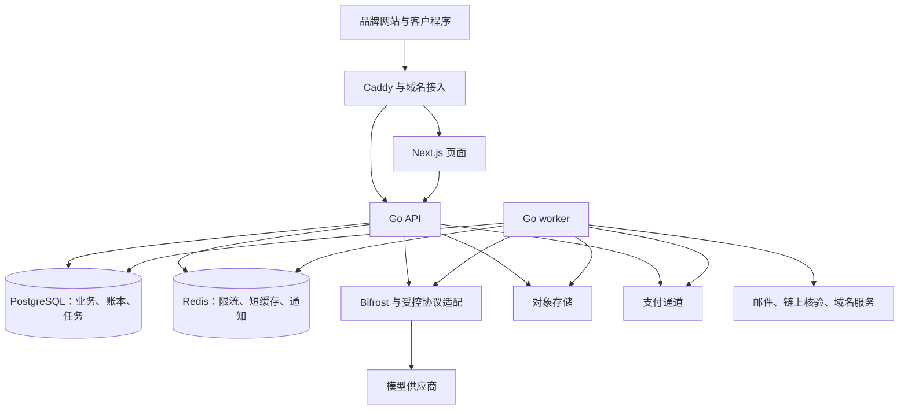
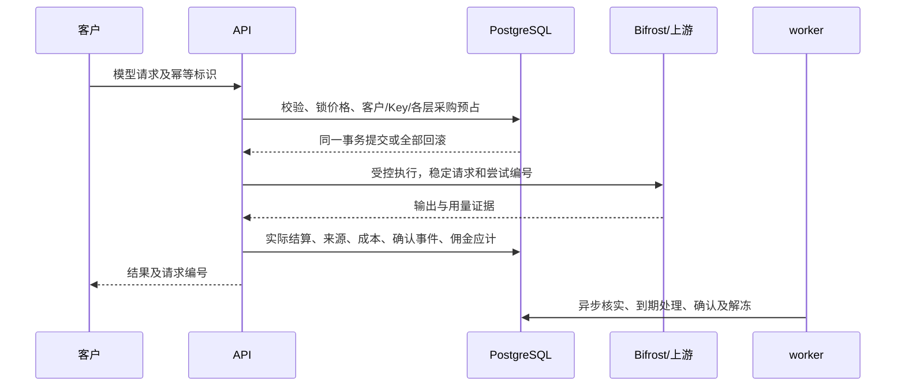

# TokenHub 重构实施方案

> 本次接入验收决定（2026-10-16）：用户确认普通线上支付和稳定币材料尚未准备好，授权完成真实驱动、官方沙箱或可复现协议联调、配置预检及明确待配置状态；材料齐全后通过配置启用。当前真实商户未实测必须明示，但不据此阻塞本轮代码交付。此决定覆盖下文将当前真实商户/小额实测作为本轮代码完成前提的默认条款，不允许用接口空壳或固定假支付替代实现。用户还授权将模型、支付等 stateful HTTP 联调服务放在仓库外 `../integration-lab/` 独立部署，业务运行默认不指向 mock。

> 实施状态更新（2026-10-16）：用户已确认产品及方案并授权实施。本轮已核对远程基线，直接在 `release/v0.1.0` 实施。发布约定已于 2026-10-18 更新：release 推送通过 CI 后自动部署该精确 SHA 到测试环境，具体门禁见 README。实际进展见[实施记录](实施记录.md)，规范中的要求不等于已经通过验收。

状态：用户已确认的重构实施基准；实际结果另记。\
编制日期：2026 年 10 月 16 日。\
业务依据：[产品说明书](TokenHub产品说明书.md)、[关键业务案例与验收标准](TokenHub关键业务案例与验收标准.md)、[一致性检查与决策清单](TokenHub一致性检查与决策清单.md)。\
实施排程与逐项覆盖：[实施工作包与验收映射](TokenHub实施工作包与验收映射.md)。

## 1 本次重构要交付什么

重构完成后，TokenHub 应当是一套由平台提供技术、各经营方独立经营的模型服务系统。四条销售链都要完整运行：平台直客、平台—渠道—客户、平台—OEM—客户、平台—OEM—渠道—客户。终端客户只接触所属品牌和经营方，通过套餐、通用 ATG、品牌 Base URL 和 API Key 使用模型。

这次不是给旧主体模型加字段，而是重建客户归属、经营关系、交易资产、计费结算和产品界面。保留现有技术基座，重新定义业务模型和接口。旧数据库、旧数据、旧业务接口、旧演示数据和错误业务测试均不构成兼容要求。

方案采用以下六项实施决策：

1. 保留 Next.js 前端、Go 模块化后端、API 与 worker 双进程、PostgreSQL、Redis、对象存储和现有部署体系；Bifrost 继续作为嵌入 Go 后端的模型接入基座。
2. 分别建模品牌、经营方、供货关系、客户服务归属和用户邀请链，禁止继续用一个“渠道”字段兼任这些含义。
3. 使用统一的高精度资产账本和来源记录。客户 ATG、采购 ATG、USD 支付余额、USD 佣金分别记账；价格、实际资金和账面成本分别记录。
4. 把涉及资产的关键动作放在 PostgreSQL 事务内完成。Redis 用于限流、缓存和任务通知，不能决定余额是否存在，也不能成为支付或佣金是否完成的唯一依据。
5. 所有模型能力走同一套受理、预占、用量归一化和结算流程。同步、流式、异步只改变执行和交付方式，不另起一套资金逻辑。
6. 先按依赖关系实现，再按完整业务闭环验收。全部 30 章产品范围、27 个案例和 135 项验收均须交付，不以某个阶段完成代替整体完成。

本文提出的精度、分摊顺序、事务方式、目录结构和默认技术期限均已随方案确认，作为实现与验收依据。具体完成情况须以代码和运行证据为准。

## 2 现有技术基线与保留范围

### 2.1 本次核实到的事实

方案编制时核查的是本地 `tokstudio` 仓库，分支 `release/v0.1.0`，提交 `9f0d43fdff8d47ecb00f60b3b105daf9fafeae44`。开始实施时已核对该提交与远程一致。以下是重构前技术基线快照，不是当前实现状态。

- 前端依赖声明：Next.js 15、React 19、TypeScript 5.7、Tailwind 3、Radix UI、TanStack Query/Table、React Hook Form、Zod、Zustand、next-intl、ECharts。保留这些选型、基础组件和适用的开发工具。
- 后端：Go 1.27、Gin、GORM/PostgreSQL、go-redis、Casbin、AWS S3 SDK、Zerolog、Prometheus、OpenTelemetry。当前 Bifrost Core 固定为 `v1.8.4`。
- 运行结构：Go API、Go worker、Next.js、PostgreSQL 16、Redis 7、MinIO/S3、Caddy，以及已有监控、备份组件。现有 Bifrost 是 SDK 集成，不额外引入独立网关服务。
- 模块已有身份、目录、网关、媒体任务、套餐、计费、支付、佣金、通知、审计、outbox 等分区，可以保留模块化组织方式，不能保留其错误业务含义。
- 支付代码已有 Stripe、支付宝、微信及线下驱动结构；本次文件核查未发现稳定币收款实现。存在驱动不代表已经通过新业务要求或真实通道验收。
- OEM 域名已有 Cloudflare Custom Hostname 接入代码，Caddy 保留反向代理和源站职责。本地 Pebble 只用于证书测试，不能视作公网域名验收。
- CI 已有 Go 测试、Vitest、Playwright 和前端构建。当前 OpenAPI 生成脚本主要提取路由列表，并不提供完整请求、响应类型校验，需要补齐。
- `release/v0.1.0` 的成功 CI 会触发测试站自动部署。重构分支不能借普通提交意外触发整站替换。

依据文件主要为 `web/package.json`、`backend/go.mod`、`docker-compose.yml`、`deploy/Caddyfile`、`backend/cmd/{api,worker}/main.go`、`backend/internal/gateway/bifrost.go`、`backend/internal/media/adapter.go`、`backend/internal/platform/db/migrate.go`、`backend/internal/outbox/`、`backend/internal/identity/cloudflare.go`、`web/scripts/generate-client.mjs` 和 `.github/workflows/`。

这些结论来自静态核查，未在本次运行旧应用或重跑其测试。README 中“渠道只负责推广”等旧描述不能作为设计依据。

### 2.2 保留、改造与替换

保留工程骨架、部署拓扑、基础设施客户端、日志监控接入、通用 UI 组件和测试工具。复用前先确认其没有把旧渠道权限、旧金额单位、旧隐式默认模型带进来。

改造 Bifrost 适配器、供应商密钥管理、支付适配器、域名接入、邮件投递、任务调度、契约生成和发布流程。它们有技术复用价值，但必须接受新的接口和业务约束。

替换主体及权限语义、用户资产与流水、采购和成本、销售覆盖、套餐与续费、推广佣金、结算异常、后台业务页面、业务 OpenAPI 和旧业务迁移脚本。旧测试仅保留仍成立的基础设施测试；业务测试按新规则重写，不能通过修改新规则使旧测试通过。

不为了业务重构主动换框架或整体升级依赖。若现有依赖不能完成已确定能力，先形成具体缺口和契约测试，再做最小范围升级或适配，并固定版本。

## 3 目标运行架构与职责

API 负责鉴权、业务命令、查询、支付回调、模型请求受理和同步/流式连接。worker 负责持久任务、异步模型任务核实、交付补偿、到期与续费、消费确认、对账、通知、域名状态刷新、导出和清理。

同一类持久任务只有一个领取协议，不再在 API 和 worker 中无条件各启动一套循环。多 worker 通过数据库领取、租约及递增执行代号协作；租约过期的旧执行者不能写回新结果。

业务模块共用 PostgreSQL，但各自拥有表和仓储接口。跨模块事务由 `app` 的业务流程编排器发起，参与模块接受同一个事务上下文，通过显式接口完成操作；不互相引用内部 ORM 模型，也不把原子结算拆成多个异步事件。

outbox 与业务提交同事务写入，worker 至少一次投递。消费端以事件 ID 和处理器名去重。Redis 丢失通知后能够从数据库继续领取；“发过消息”不等于“业务处理成功”。新增消费者需要明确历史回补策略，不能只从启动时间之后开始读而漏掉待处理责任。

## 4 领域模块与持久化设计

以下名称为建议实施边界，最终 SQL 名称可调整，含义和约束不能合并丢失。业务 ID 使用稳定 UUID，金额接口使用十进制字符串，时间持久化为 UTC，业务日历另存 IANA 时区及规则版本。

### 4.1 主体、客户与权限

`identity` 管认证与登录安全；新增 `organization` 管经营关系；`branding` 管域名和展示。

- `brands`：官方品牌或 OEM 品牌，有唯一经营主体；域名不充当品牌主键。
- `operators`：平台、OEM、渠道。平台唯一；OEM 属于自己的品牌；渠道属于其直接上级的品牌。
- `supply_agreements`：供货方、采购方、合作状态、报价和退出条款引用。只允许三种直接供货边：平台→OEM、平台→官方渠道、OEM→自己的渠道。
- `customers` 与 `customer_identities`：品牌内唯一的规范化已验证邮箱、认证状态及不可重置的新客身份记录；跨品牌允许相同邮箱。
- `service_ownerships`：客户当前经营归属、版本和生效历史。普通资料编辑无修改归属能力；完整渠道接管由专门流程切换。
- `referral_edges`、`invite_codes`：用户直接邀请关系、用户码与渠道码。与供货关系分表；不通过经营方的父级推算用户佣金。
- `staff_memberships`、角色和权限策略：人员可拥有明确授予的经营空间权限，客户账号不因此变成团队组织。
- `operator_statuses`：新增销售、存量履约、资金结算、合作退出分别管理，不用一个 `enabled` 清除全部服务。
- `brand_domains`、品牌主题与渠道覆盖配置：域名唯一且验证通过后启用；主题逐字段继承，保存配置版本及审计记录。

数据库至少约束品牌内邮箱唯一、邀请码唯一、客户只有一条当前归属、邀请人和被邀请人不能相同且注册归属一致、经营关系无环。接管后邀请边保持原客户 ID，不重新挂树。

Casbin 负责动作权限，服务层和查询仓储负责数据范围。平台技术人员、上级合作人员、下级财务人员是不同权限集合。页面隐藏按钮不能替代服务端约束。

### 4.2 目录、报价和模型执行

`catalog` 管供应商、加密密钥、上游模型、公开模型、能力、模型授权、上架和价格；`gateway` 管请求生命周期；`media` 保留为异步交付适配层，不再独立管余额。

核心记录包括 `providers`、`provider_credentials`、`upstream_models`、`public_models`、`capability_versions`、`route_versions`、`model_grants`、`listings`、`price_versions`、`request_price_snapshots`。公开模型 ID 稳定，供应商路由变化不能改掉用户指定模型。

每种计价组成明确单位和适用条件，例如输入、输出、缓存命中、图片规格、音频时长、视频规格、单次费用。零售和每条供货边各有自己的价目；供应商真实 USD 成本另存，不能由零售倍率倒推。

价格版本保存生效区间、手动/跟随规则、上游来源版本、促销覆盖层及通知状态。新价格先形成草稿，校验和重算通过后按时间发布。限时价格结束后重新解析届时常规版本，不复制旧常规价回来。

### 4.3 统一资产账本

新增 `ledger` 作为唯一资产写入入口；`billing` 保留计量结算职责。核心记录为：

- `ledger_accounts`：资产所有人、承担责任经营方、币种或额度单位、资产类别及用途。
- `journal_transactions` 与 `journal_entries`：业务动作和同单位平衡分录，保存业务来源、幂等键、原交易/冲正关联、操作者、版本和时间。
- `account_balances`：与分录同步更新的余额投影，包含总额、占用和可用值；可以从分录及占用重建核对，不能绕过账本直接编辑。
- `holds` 与 `hold_allocations`：购买、提现、退款、请求等各自占用，保存到期、释放/消费状态和来源明细。
- `credit_grants` 与 `grant_sources`：客户套餐或独立赠送的 ATG 来源、购赠分类、有效期、剩余量、实付分摊和原订单。
- `procurement_lots` 与 `procurement_positions`：每条供货边的来源批次及数量、实际成本总额、移动平均计算依据。来源批次用于追溯和退出，不锁调用价。
- `rounding_carries`：小于记账精度的累计余数及可审计的归属。

USD 支付余额、佣金冻结/可用/占用、客户 ATG、采购 ATG 不能互相借用。现金责任和服务责任分别对账。USD 与 ATG 不在同一组分录中相加抵平；一次套餐交付通过同一业务 ID 连接 USD 交易和 ATG 权益两组记录。

账本是业务资产子账，不替代各经营方的法定财税账。供应商成本、采购库存价值、应付佣金、支付费用和异常损失有对应记录，支持报表对账。

### 4.4 商品、资金与售后

`commerce` 负责订单和交付，`plans` 负责商品及续费，`payment` 负责外部资金事实，新增 `settlement` 负责退款、提现、争议和清算。

持久化包括套餐及版本、批发报价及版本、订单/条款快照、支付资金来源、收款事实、收款分配、交付任务、续费授权、退款单、提现单、外部扣回事件、对账差额和票据申请。

订单类型包括套餐、支付余额充值、采购。它们复用收款及分配机制，但交付不同资产。每笔订单绑定销售经营方、受益客户或采购方、实际收款方、USD 应付、报价版本、有效期、资金来源以及授权证据。

外部收款唯一键必须包含通道和商户空间；链上收款唯一键包含网络、交易和具体转账事件。交付以订单和交付类型唯一，支付回调多次到达不能多发资产。

### 4.5 推广、营销与生命周期

`commission` 负责确认事件、资格历史和佣金；新增 `marketing` 负责活动、条件及占用；`cooperation` 负责退出与接管。

主要记录包括消费确认事件、资格累计及正式取得记录、分佣功能状态、订单分佣快照、佣金应计和冲正、待抵扣、经营方/KOL 活动、参与次数、奖励承诺、超卖设置、覆盖责任、风险快照、补货授权、接管方案和交接清算单。

`audit`、`notifications`、`reporting`、`ops` 提供横向能力，但不能从审计或报表反向修改资金。举报、风险冻结、注销和例外审批都有独立事项编号、状态、期限与处理历史。

### 4.6 请求记录、关键约束与索引

`model_requests` 保存品牌、客户、稳定 Key ID、受理时经营方及归属版本、公开模型、受理时间、预算窗口、价格快照、预占和执行/核实截止时间。`request_attempts` 保存每次上游和密钥引用、提交状态、供应商请求/任务 ID、是否已交付输出、错误及成本证据；不保存密钥原文。`usage_facts` 保存可验证的用量组成、来源、核实状态和接收时间；重复证据不能再次结算。

`request_settlements` 连接本次各单位金额、采购层扣量、客户来源分摊、经营方缺口、成本和确认事件。`key_budget_windows` 以稳定 Key ID 和窗口起止唯一，保存预算规则版本、已发生、预占及超额，重置密钥不创建新的空预算。修改限额只改约束，不清零已发生和在途占用。

关键唯一约束包括：每笔业务资产动作的幂等键、每条请求的初始结算、每笔收款的外部事实标识、每笔订单的交付、每来源确认事件、每确认事件与受益人的佣金份额、每任务的业务执行键。冲正通过新 ID 和原记录关联表示，不覆盖原唯一记录；部分多次冲正累计不得超过原可冲金额。

所有资金/权益来源保持品牌、经营责任和资产单位一致，数据库外键/检查约束与服务校验共同保证。余额非负、占用不超总额、来源扣减不超来源剩余、收款分配不超可分配额等约束，不能只写在前端校验里。待抵扣和经营损失使用专门记录，不破坏客户余额非负约束。

必要索引包括经营方+时间的订单/流水、客户+到期顺序的有效来源、账户+状态的占用、状态+可执行时间的任务、状态+确认时间的消费事件、供应商任务标识、品牌域名及来源关联。对活跃任务、当前归属和有效占用使用适当的部分索引。财务事实和请求元数据可在容量验证后按时间分区，不能以分区删除实现无条件删账。

## 5 金额、时间、来源和快照的统一规则

### 5.1 精度及计算

建议 USD、ATG 和库存成本使用 PostgreSQL `NUMERIC(38,18)`；单价、倍率和比例可用 `NUMERIC(38,24)`。Go 使用 `math/big` 封装不同量纲的金额类型，中间乘除使用有理数，禁止 float 参与资产决策。接口用十进制字符串，前端展示和输入校验不经过 JavaScript Number 的金额运算。

最终记账精度之下的正负余数按账户、规则和来源持续累计；余数保存可复算的分子、分母，不直接截掉。上游计价精度超出当前支持范围时，必须先验证扩展或给出明确配置错误，不能把小费用静默变成零。累计达到最小记账单位后形成对应增量。外部支付再按通道单位拆成可执行金额和保留尾数。

比例分摊采用累计目标减历史已分摊值，同一事件使用固定来源顺序处理剩余最小单位，最终结清时归尽合法尾差。金额、ATG 来源和佣金余数分别守恒。冲正反向关联原分摊及其余数变化，不能用今天的比例重算旧账。

### 5.2 扣减与成本的确定顺序

客户权益按 `expires_at ASC NULLS LAST, effective_at ASC, grant_id ASC` 选择。在一个订单内，把购买、自带赠送、经营方活动赠送和 KOL 赠送作为同一比例组；预占同样按来源占用，结算和释放保持来源对应。独立赠送是独立权益组。

采购来源按交付时间和批次 ID 顺序扣减，同采购批次购赠按比例拆分。这个顺序只决定来源归属；本次成本按结算事务中该采购账户的移动加权平均计算。

采购库存保留剩余数量 Q 和剩余账面成本 C。补货后为 `(C + 本次入库成本) / (Q + 本次全部采购 ATG)`；消费 x 的成本为 `x × C / Q`，随后同时减少数量和成本。退款或接管移出也转出相应账面成本，合同现金结算差额单列。不能把“可退款原实付”误作库存单位成本。

### 5.3 实付、有偿调用及资格

每个套餐订单保存有效实付 P、基础购买 Qp、最终全部额度 Qt。某次该订单实际扣减总额 q 的有偿基数为 `P × q / Qt`，与 `P × 已扣购买额度 / Qp` 核对；无实付订单为零。使用余额或佣金支付仍计实际有偿支付，但不增加外部现金流。

已用、到期、异常取消/退款和剩余购买价值构成互斥分类。每个订单累计确认的调用及到期价值不得超过有效实付；到期只影响资格和到期统计，不产生佣金。

例如最终支付 80 USD、基础购买 80 ATG、自带赠送 20 ATG，KOL 让利 10 个百分点再赠 10 ATG，最终共 110 ATG。消耗 22 ATG，购赠分别为 16、4、2 ATG，有偿基数 16 USD；若订单直接佣金为 15%，实际直接佣金为 `16 × (15% − 10%) = 0.8 USD`。不是按 22 USD 计佣，也不是把加赠先用完再计佣。

### 5.4 各类时间和快照

- 受理时：锁定零售及全部供货价格、计量规则、请求能力、客户归属版本、Key 预算窗口和执行/核实期限。
- 购买时：锁定套餐、实际价格、购赠组成、活动、分佣比例、KOL 让利、续费本次条款和原资金来源。
- 实际结算形成消费时：确定两跳邀请人的有效分佣资格、当时确认规则和确认到期时间，保存当次采购成本。
- 消费成熟时：增加资格确定金额并释放相应佣金，不再额外叠加一轮冻结期。
- 提现申请时：锁定 USD 金额及费用；外币或稳定币的实际付款数量在执行时记录，不锁未来汇率。

经营时区用于自然预算窗口和日历周期。已经生成的窗口、权益期限和计划续费时间不因改时区重写；时区变更对未来安排生效并通知，不能产生重叠预算窗口。月末取目标月末，周期使用明确的起止时刻，时间边界采用左闭右开。

## 6 四条核心交易流程

### 6.1 注册、归因和奖励

先由已验证 Host 找到品牌，再解释用户码或渠道码。正式提交展示的经营方和邀请码作为本次注册意向，邮箱验证凭据绑定该意向；显式修改需更新意向，不读回陈旧浏览器缓存。

正式注册事务执行邮箱唯一性校验、客户和固定归属创建、邀请边建立、本人邀请码生成、适用奖励资格判断和奖励交付。邀请人资格先按已到期确认事件同步到正确时点。

奖励在向用户作出承诺时就检查销售覆盖并建立有期限的承诺占用。正式验证后兑现；技术故障留下待交付事项。仅有草稿或未完成注册不发奖。前端明确展示奖励是否适用，不能先宣传已获得再因内部覆盖不足静默取消。

### 6.2 购买和续费

下单事务先确认客户归属、商品版本、活动资格/次数、最终 USD 与 ATG、续费授权和销售覆盖，建立订单及活动/履约承诺占用，并占用所选内部资金。外部付款在事务外发起。

收款回调或线下核实先形成不可重复的收款事实，再分配到订单。足额后交付事务消费内部资金占用、核销外部收款分配、生成 ATG 来源、核销活动和承诺、固定到期时间、记录分佣快照，最后写通知事件。

收款事实即使已存在，交付仍可以暂时失败。此时必须保留已付款待交付状态，由同一任务重试；不得再次收钱，也不得把未履约款项伪装成已完成订单。真正无法交付进入异常退款。

正常超时未付款订单释放占用；回调迟到但实际支付在有效期内时兑现原条款并处理承诺恢复，不能按新价格交付。实际迟付、超额和重复真实付款进入待处理收款，不能与重复回调混为一谈。

续费授权独立保存，不等于支付通道自动扣款授权。本方案按产品规则只从 USD 余额及用户允许的可用佣金筹资。worker 以订阅和应续周期唯一建单；条件变差必须取得具体版本的新确认。无资金或未授权不续费，当前套餐按原期结束。

### 6.3 批发采购与供货

采购使用订单、收款和交付公共流程，交付目标是对应供货边的不过期采购 ATG。该批次记录购赠来源、实际 USD 和退出条款，同时更新数量与平均成本。OEM 售给渠道时，OEM 自身对平台的销售覆盖也要通过。

自动补货是独立授权：触发条件、允许报价、单次和周期金额、支付方式、取消及失败处理。数据库唯一约束阻止同一采购账户重复发起在途自动补货。能真实自动付款的通道才可自动执行；线下方式产生待付款采购单和提醒，核实前不加额度。

渠道向 OEM 补货与 OEM 向平台补货分别发生，不通过一笔下游收款隐式提升上游采购余额。

### 6.4 模型受理与结算

受理分为四步：

1. 认证与能力检查；限流准入；请求规范化及幂等指纹校验。
2. 解析当前有效目录、零售和逐层供货价，计算客户合理预估和每层可证明的最大采购费用。上界包括全部可能收费组成及安全切换候选，不只看文本输出 token。
3. 一个事务内，按统一锁顺序校验客户/Key 可用预算、客户来源和全部采购余额，记录请求、价格/归属快照及全部占用。任何失败全部回滚，不调用上游。
4. 提交后调用上游；数据库锁不跨网络请求持有。若提交成功后进程中断，恢复程序依据持久请求状态判断是否提交过上游，未知状态先核实。

结算事务按第 9 节顺序取得包含请求在内的全部必要锁，校验唯一结算键；使用可靠用量计算本次零售、各层供货扣量和实际供应商成本。先使用本请求预占，不足再取客户仍有效、未被其他请求占用的 ATG。Key 记真实应计消耗及超限值；客户不足部分单列经营方损失，不成为用户负债或佣金基数。

每层采购只消费已有可靠预占以内的实际金额，释放余量；正常一次请求仅有一次层级结算。技术上界失误或内部额外尝试由平台异常成本及必要的层间补偿记录承担，不能通过负采购余额或再扣一笔采购掩盖。

同事务写入来源分摊、已锁价格、成本、客户有偿基数、两跳资格快照、冻结佣金、消费待确认事件、占用释放及 outbox。报表和通知可以稍后完成，余额、基数和应计佣金不能靠无保证的异步拼接。

用量暂缺时进入有截止时间的待核实状态。截止后仍不能核实则终结为不收费，释放客户及采购占用；上游实际损失归平台异常账。迟到事实只补充技术成本和排查证据，不重新扣客户或下游采购。取消、断线和部分交付按可靠用量与故障责任处理。

## 7 销售覆盖、独立定价与预警

### 7.1 覆盖不能只做成一个报表

每个存在上游的经营方维护销售覆盖账户，单位是该供货关系的采购 ATG。超卖额度也使用此单位，页面同时解释其与当前客户额度的换算，不称为 USD 授信。平台自有品牌没有系统内上游采购账户，管理供应商履约风险，不凭空生成一个平台向自己采购的账本。

对正的零售价和对应采购价，求所有已开放模型、计价组成和适用阶梯的最大比值 k。客户未占用的有效 ATG 乘 k，构成直接客户责任上界；独立赠送也参与。包含固定费用、规格组合或非线性阶梯的模型，须用覆盖整个允许输入范围的上界函数，不能用一个简单平均比值替代。

对 OEM，还要将各渠道未被调用占用的采购 ATG，按 OEM 对该渠道的供货价与 OEM 上游采购价之间的最大比值折算成对平台的责任。渠道终端客户 ATG 不再加一次。同一责任在请求预占后从未占用责任中移出，对应采购预占从可用采购余额中移出。

例如 OEM 对平台剩余采购 200 ATG，其中 20 已预占；直属客户未占用权益折算需 60，渠道剩余未占用采购余额折算需 90，待成交承诺需 10，超卖额度 30，则可新增承诺为 `180 + 30 − 60 − 90 − 10 = 50`。进入超卖前的正常空间只有 20，预警必须在正常空间耗尽前发生。

采购价大于零而对外价格为零时，有限客户 ATG 不能约束免费调用数量，覆盖系数没有有限值。该配置不能直接发布为无界服务；本方案通过赠送 ATG 做免费体验。若将来需要长期零价模型，必须另外定义次数/时长等有界履约规则，不能绕开当前覆盖约束。

### 7.2 并发与价格版本

销售、赠送、续费、采购交付、退款、到期和调用占用变化同步更新责任投影；新增承诺前对覆盖账户加锁校验。并发下单不能都读同一份余量后分别成功。

价格、上架和授权变化先生成新覆盖版本。发布与新增承诺共享版本校验，避免新价格生效而销售还用旧 k。影响对象较多时，先准备各经营方的新投影，再切换生效版本；紧急变更立即限制受影响的新增承诺，并完成重算。重算期间不能拿过期覆盖数据放行销售。

已售权益永远保留。调价、及时付款的迟到通知等造成覆盖缺口时，形成责任和告警，限制新增承诺并要求补货，不回删权益，也不把已收款订单当作未发生。

采购余额不足、模型不可用和销售覆盖不足是三种不同状态，分别决定调用、新购及运营提示。前台只有对应套餐或活动受限，不把整个账号的结算和查询入口一起关闭。

### 7.3 预警与补货联动

风险记录至少包含真实采购可用额、正常销售空间、超卖使用量、到上限余量、待付款承诺、近期消耗速度和待补货订单。阈值及接收人由经营方或约定上级配置；系统有接近阈值、使用超卖、接近上限、售空、调用不足、恢复几个状态。

告警去重、冷却、升级和恢复分别持久化。上级只读取自己的供货和汇总风险，不能由风险入口钻取未授权客户账单。自动补货依原授权触发，有在途订单就持续追踪，不反复新建。

## 8 Bifrost、能力接入与请求恢复

### 8.1 保留 Bifrost，收回业务决策

TokenHub 决定公开模型、候选上游、能力要求、密钥权限、价格和收费；Bifrost 负责模型协议接入及受控执行。Bifrost 的内部模型价格、缓存、自动工具循环或 fallback 不能代替 TokenHub 业务判断。

核对当前固定版本的[官方源码](https://github.com/maximhq/bifrost/blob/core/v1.8.4/core/bifrost.go)，其具备 Chat、Responses、Embedding、图像及视频等方法。具体供应商是否完整支持某个方法仍需逐项契约验证，不能由方法存在推断所有路由可用。

实施时建立三层接口：

- 请求协议层：保留输入、工具调用、多模态内容和用户明确参数，生成所需能力集合。
- 执行适配层：返回执行状态、输出事件、供应商任务 ID、尝试事实和原始计量证据；不接触客户余额。
- 计量适配层：把证据归一成明确单位的用量，给出证据来源、可靠性和最大费用约束结果。

不支持的参数明确拒绝或由用户显式修改，不静默删除、转成普通字符串或切换默认模型。必要的原生协议适配仍通过统一路由和结算编排，不能直连出一条绕账路径。

### 8.2 完整能力交付方式

建立供应商—公开模型—能力—计量组成的可执行目录。文本同步/流式、Responses/工具调用、Embedding、图像、语音、视频及异步任务根据上游真实能力接入；同一产品模型不强求每种调用模式都支持。

每类能力必须至少有可运行的真实适配及验收样本，目录页面只公布已经通过能力、计量、上界和失败恢复验证的组合。后续新增供应商按同一接入检查流程进行，不能只修改前台列表就视作接入完成。

现有供应商适配先完成迁移验证，再补齐新业务需要的能力。实际开放的供应商和模型清单、密钥及外部采购权限属于上线配置，见第 18 节；不能用固定假响应替代缺失上游并宣布全能力交付。

平台无有效上游密钥时，经营后台仍应可启动并配置供应商；模型调用显示配置缺项，不要求业务系统为了启动先填一个演示密钥。

### 8.3 重试、流式和异步

只保留一层可观察的重试编排。TokenHub 为每次尝试生成 ID，Bifrost 只能在本次已校验候选和密钥内执行；内部隐式重试要么关闭，要么通过钩子完整登记并受同一上界、期限控制。不能让 SDK 在未知成本的另一模型上继续尝试。

流式采用背压转发，记录是否已经交付内容。首段输出前可安全切换；交付后不重新生成拼接。断线不直接假定上游已停止，仍进行取消/核实和结算。

异步任务分开记录本地请求、提交尝试、上游任务、查询结果和交付状态。提交超时后先查询原任务或使用上游可靠幂等标识；无可靠查询/幂等保证时保持未知并进入核实，不盲重提。查询与重复下载不是新消费。

客户端取消仅是请求取消动作，不直接改已确认用量或释放尚可能消耗的采购占用。所有等待都有最晚终结时间，超出后按不收费规则结案并记录平台成本风险。

### 8.4 幂等与内容最小保留

资金和业务命令的幂等记录长期随业务记录保留。模型调用使用 `(品牌、客户、Key 稳定 ID、操作类型、幂等标识)` 唯一约束，保存带密钥的规范化内容摘要、状态和请求 ID；原始请求内容不进入账本或普通日志。

建议同步请求的短时结果重放缓存为完成后 10 分钟，异步结果默认完成后 24 小时；异步临时输入仅保留到执行/核实结束。模型可因上游交付方式采用另一个已公布期限，创建任务时固定给客户。短时缓存是交付机制，不提供会话历史或长期保存开关。

结果被清理后，同一幂等标识返回原状态及“结果已过暂存期”，不再次执行。流式重试返回原请求状态，不承诺重播已经发送的全部流。幂等防重复元数据作为请求账务关联保存，内容缓存消失不使旧标识变成新调用。

临时内容使用独立对象存储前缀、权限和生命周期；短时缓存有容量限制、到期清理和删除核查。持久任务队列只放对象引用，不把完整提示词塞入长期 outbox。通知、审计、追踪和 Bifrost 日志统一脱敏。

## 9 并发、失败恢复与账务完整性

### 9.1 锁与原子性

定义全局锁层级：合作/覆盖配置版本、相关经营及采购账户、客户与资格账户、Key 窗口、权益来源、业务对象；同层按稳定 ID 排序。具体事务先收集完整锁集合再加锁，锁定后重新核对归属和配置版本；不一致时退出重试，模块不得临时反向取锁。实现阶段用相反请求顺序的并发测试验证。

余额、活动次数和覆盖通过行锁或带版本条件的原子更新控制。唯一约束兜底注册、订单交付、请求结算、消费确认、佣金解冻、退款支付记录和活动核销。死锁/序列化失败可以有限重试数据库事务，不能因此重新调用支付或模型上游。

采购总账户可能成为高并发热点。先以短事务保证正确性，用压力测试定位等待；优化索引、批量写和非资金读取。不能为提速把真实余额改成异步汇总，或按 worker 各发一份可花余额。

Redis 限流使用原子脚本；并发租约由持久请求状态辅助恢复。Redis 故障或状态重建期间采取保守准入，避免恢复瞬间无限放行。精确资金约束始终在 PostgreSQL。

### 9.2 状态机

- 请求：已预占 → 执行中 → 待用量核实/可结算 → 已结算，或明确终结不收费。取消状态与最终计费结果分开。
- 订单：待付款 → 单笔足额付款待交付 → 完成；关闭和异常待处理不抹去已收款事实。
- 占用：有效 → 已消费/已释放；部分消费后释放余额，不能同时执行两种终态金额。
- 消费确认：待确认 → 已确认；争议暂缓为独立阻断状态，冲正以新事件关联。
- 退款/提现：申请占用 → 审核 → 待执行/执行待核实 → 已执行；明确失败/取消释放，未知不重付。
- 接管：草案 → 核算确认 → 进入交接 → 核对完成 → 原子生效 → 双方清算跟踪；不能以一个“改渠道 ID”按钮代替。

不可逆的记账结果用新增事件修正，业务对象可更新当前状态，但必须保留完整状态历史和操作者。

### 9.3 可恢复任务

每个任务保存业务幂等键、可执行时间、尝试次数、租约、执行代号和最后错误。领取采用数据库行锁/跳过已锁行，超时可以被接替；前一执行者回写时检查代号，阻止过期结果覆盖。

外部调用前先保存调用意图及幂等键，结果不明先查询。回调入口验证签名和商户上下文后保存 inbox，再响应成功；数据库不可写时不得提前确认已处理。重复回调和乱序状态按外部事实版本及业务终态处理。

人工“重试”沿用原业务 ID；“冲正”创建对应反向动作；“忽略”必须给出责任处理结果，不能删除挂账。运营后台能看见逾期占用、已收款未交付、未知支付和失败任务，不能只能到日志里找。

## 10 推广、资格与营销的实现

### 10.1 确认和资格不能依赖 worker 是否及时运行

调用结算和到期归类产生独立的确认事件，记录实付价值、发生时点、确认规则版本和应确认时点。worker 负责按时处理，但注册奖励判断、下级消费分佣判断和资格页面关键动作都调用相同的“推进到当前业务时点”逻辑。

该逻辑在资格账户锁内处理已到期且无争议的事件，并核对当时有效门槛。正式资格保存取得时点和门槛版本。因此 worker 延迟不会让本已达标的人少拿后续佣金；门槛降低也不是等待全量批处理结束才受益。历史消费仍按消费时的快照，不因稍后补算资格而追溯改账。

确认事件、争议阻断、门槛调整和分佣状态都有生效时序。与结算同刻并发时使用数据库确定的业务序列作稳定先后依据，不使用请求机器各自的本地时间决定权益。

### 10.2 佣金处理

结算读取固定两跳客户 ID。每跳分别判断正式资格和功能状态，适用原订单比例；不合格份额不转移。产生冻结应付，消费确认后同事务解冻，优先处理该人的待抵扣，再进入可用佣金。

资格累计可以因纠错下降，正式取得记录不撤销。分佣功能可按确认违规或正式注销停止未来产生，不能借此回收此前正确佣金。可疑阶段继续应计，只阻断相应释放或使用。

错误佣金先撤销对应冻结，再扣可用，不足创建待抵扣；已经进入提现付款且结果未知的金额不得当作可用直接回收，应保持原付款核实流程，缺额记录待抵扣。后续正常套餐不回收，支付余额和 ATG 不抵扣。

### 10.3 活动及奖励

经营方活动与 KOL 活动分别配置条件、有效期、套餐范围、每人次数及总预算。跨活动次数按 KOL 和客户形成独立计数，不用浏览器 Cookie 计数。每单最多各一个，组合必须有明确授权配置。

下单时固定活动及原套餐基础额度；KOL 加赠只按基础总额乘让利百分点，不乘经营方额外赠送。下级必须是该 KOL 的直接邀请客户；同一品牌不同经营方或别人的下级都不通过。

活动修改创建新版本，已经占用的有效订单按原版本处理。未来佣金规则降低导致让利超出直接比例时禁止新成交并通知 KOL，旧订单不改。次数在下单占用、交付核销、明确失败释放；发生异常退款后依已固定活动条款处理，不默默把用户重新变成新客。

## 11 支付、稳定币、退款与票据

### 11.1 商户收款与资金事实

每个经营方独立维护并启用收款配置，密钥加密存储，平台技术接入权限不等于运营方资金权限。保留现有通道适配体系，重写其经营方归属、回调验证、收款分配和异常状态接入。

驱动契约至少提供创建收款、核实/查询、验证回调、获取执行明细及通道支持的退款查询。普通支付与采购支付复用事实层；经营方之间不共享待分配现金。线下收款由有权限人员登记实际到账凭据，配置了复核的事项先复核再生效。

金额固定 USD 应收/应付，保存原币种、数量、实际执行时点、外部执行标识、费用和入账 USD 依据。不存一个供日后退款沿用的锁定汇率。商户实际到账扣除了费用，不减客户已足额支付对应的订单权益。

退款执行按 USD 责任及原资金来源分配，恢复钱包或佣金、外部原路退回分别办理。外部通道只能退原币金额而不能完整履行当前 USD 责任时，保留差额并进入异常结算，不宣称自动消除汇率差额。

代付保存付款人与受益账号的区别，权益及资格归订单客户，不给付款人额外账号权限，也不产生后续代扣授权。

### 11.2 第三方稳定币通道

实现与法币通道同级的稳定币支付驱动，保存通道商户、订单、资产、网络、付款要求、实际执行 USD、到账和退款事件。须完成签名验证、主动查单、重复/乱序通知、少付/多付/迟付、失败/未知退款及费用对账。

至少完成一个真实第三方通道适配和其允许的测试/小额实测。具体厂商取决于经营主体可开户范围及所需网络，不能在未取得条件时擅自替用户选商户或开户。第 18 节列为外部接入选择；这一项未实测，不将第三方稳定币能力标记完成。

### 11.3 经营方自有钱包

系统只登记收款地址和核验配置，不保存私钥、不代为签名，也不自动归集或代发提现。每种支持网络有只读核验适配器，配置允许的币种合约/资产标识、精度、确认规则和核验服务。

收款识别以网络、交易哈希、转账事件索引或输出索引、接收地址构成唯一事实；一个交易中多笔转账不能互相吞掉。核实资产、合约、网络、目标地址、数量、执行成功及所需确认。客户提供哈希只是定位线索。

订单匹配优先用经过验证的独立收款标识；共享地址不能仅凭金额相同自动认领，可由经营方核实后分配。稳定币不默认永远等于 1 USD，自有钱包需要保存实际可验证的入账 USD 依据；依据缺失时保持待核实，不凭市场名称发额度。

链上重复扫描、核验节点失败、确认不足及重组均有持久游标和状态。已确认后发生撤回走外部扣回流程，不删除原收款。退款登记实际外部转账，不能盲目退往原发送地址，因为它可能属于交易所或代付方。

发送端费用由付款人承担；商户收款、退款费用由经营方承担。报价和页面说明足额要求，不能收到扣费后的净额就任意减发已约定权益。

### 11.4 退款、提现和争议

客户界面不出现套餐普通退款按钮；提供停止续费、未用 USD 余额退款及异常工单。异常套餐退款按原实付未履约价值，注销/到期不自动新增退款权。

提现只做申请占用、审核、付款事项、实际付款登记及核实，不接自动转账 API。截图或审核结果不能直接当作付款完成。通道退款允许按其实际支持能力执行，但同样需要结果核实和幂等保护。

外部支付争议单独记录“付款本身无效”和“商户结算受限”。冻结仅覆盖有关资产/佣金。付款无效按来源取消剩余权益、冲正错误基数佣金；纯结算冻结不撤销客户权益。外部扣回占用可退责任，防止同一责任再次退款；撤回后返款仍追加记录并复核，而非删除争议历史。

冲正按原账反向处理。原 ATG 有效则恢复原来源；已到期则归到期，不另发补用期限。赠送补偿是独立营销动作，要检查履约覆盖。正确上游履约不因下游收款风险自动退回。

### 11.5 票据

提供交易凭证、开票申请、经营方审核、外部开具后的登记/上传、客户下载及作废/重开关联。经营方配置开票环节和可开金额，同一经济交易在充值、购买及消费之间不能重复超额开票。

票据文件放私有对象空间，凭权限签发短期下载链接；税费拆分仅用于记录，不改变含税最终实付和已确定权益/佣金基数。实际开票服务和税务申报仍由经营方负责。

## 12 渠道接管、经营退出与账号处理

### 12.1 一次接管要转移完整责任

接管以品牌和渠道之间的合作协议或明确决定为依据。先生成清单：客户归属、所有有效和在途 ATG、现金余额、冻结/可用/占用佣金、待提现、待抵扣、未完成收款交付退款、争议、续费授权、活动承诺和供应关系。

清单同时列出 Key 状态及窗口预算、邀请边、KOL 资格与功能状态。未来佣金义务来自原订单快照，不仅是已经生成的佣金余额。占用是对应资产的子集，不能把余额和占用再加一遍作现金责任。

计算一次性服务承接价，先用原渠道采购 ATG 抵服务责任；购赠都可用于其合法服务价值。余额中可退的购买部分再按合同 USD 价值参与现金清算。每一项分别保存数量、账面成本、承接价值和现金结算价值，不能用 ATG 面值统一替代。

品牌承担未来履约风险和收益。接管后的实际费用、到期和佣金不再逐笔向原渠道追补。双方未结缺口单独挂账，不减少客户余额；该抵扣也不增加 OEM 对平台的采购资产。

### 12.2 原子切换与在途处理

接管采用可恢复交接任务，而非脚本批量改外键：

1. 准备并核对全量责任快照、承接条款和估值。历史订单与收款保留原销售/收款主体，另建责任承接记录。
2. 进入有明确状态的交接窗口，限制该渠道新增经营承诺和资金变更，核实所有在途请求、付款及退款；客户查询与已受理请求按原规则处理。未知外部付款不能简单取消重付。
3. 以归属版本阻止旧执行者写入。对已受理请求先结算或按既有期限终结，剩余待处理事项明确承接方和原业务 ID；支付回调仍可接收并进入待处理 inbox。
4. 在一致的最终清单上创建责任承接分录和归属新版本，原子生效。客户、Key 和邀请边 ID 不变，当前经营方由服务归属解析，不写死在长期 JWT 或 Key 中。
5. 生效后恢复业务，回调和待办按新责任方处理，原凭据和原收款方仍可追溯。不能由双方同时对一笔退款付款。

客户量较大时，先分批准备尚未生效的清单和投影，最终切换生效版本，不能让一半客户已转、一半还在旧方。实施测试必须覆盖切换前后崩溃、回调迟到、同时调用、到期和确认任务，核对每项责任只承接一次。

原渠道活动停止接受新的订单；已经成立的活动订单/奖励承诺随责任承接。存量续费按原授权和原订单条款继续或经合法变更确认，新购采用品牌方商品及规则。品牌域名与 API 入口不变，客户无需换 Key。

### 12.3 退出、违规与注销

经营退出先停新增业务，再完成存量履约、结清或接管。OEM 不能像渠道一样由平台自动接管；OEM 退出涉及其下属渠道责任，不得直接删掉经营方记录。采购日常退款不开通，退出时按原报价合同处理。

风险事项支持按请求、活动、佣金来源、资金操作等范围冻结，记录原因、复核期限和申诉。确认违规时追踪具体异常收益，不能统一清空正常资产。临时冻结不改邀请链，正常后恢复相关释放。

客户停止使用只关 Key 或续费。正式注销先列待办并明确停止未来分佣的时点，清理存量责任后匿名化非必要资料；保留必要账务和去重身份凭据，防止重新注册换渠道或重领新客权益。已放弃的套餐也要记录明确授权，不以注销按钮代替放弃现金尾数。

## 13 网站、页面和 API 合同

### 13.1 页面组织

沿用一个 Next.js 应用，通过品牌上下文和明确权限显示不同工作空间，不复制 OEM 前端工程。

- 公共入口：品牌/渠道介绍、实际经营方和收款主体、模型能力及实时价格、套餐活动、邀请码归因、注册验证、登录找回、下单付款及支付进度。
- 客户工作台：资产及占用、套餐与续费、购买记录、API Key 和预算、模型调用说明、简单体验、异步结果、按请求账单、通知、USD 退款、票据及账号处理。
- 推广工作台：邀请码、脱敏邀请链效果、确认/待确认资格金额、冻结/可用/占用佣金、待抵扣、KOL 活动、提现办理进度。
- 经营管理：商品和活动、模型上架定价、客户服务、奖励、分佣规则、收款配置、订单交付、收款分配、退款冲正、提现、票据、人员权限、复核事项、通知和报表。
- 合作管理：OEM/渠道开通、品牌和渠道定制、授权、采购报价、采购与供货、销售覆盖、超卖、汇总风险、退出及接管。
- 平台技术管理：供应商密钥、上游/公开模型、能力和计量、路由与健康、用量证据、内部尝试、故障和异常成本。客户内容不成为默认排障页面。

每个页面交付加载、空状态、无权限、配置缺项、失败、处理中和成功状态。失败要说明是账户不足、Key 超限、采购不足、模型停用还是支付未核实，并提供权限允许的下一步。运营操作均能追到对应业务编号。

客户看到品牌统一 API Base URL；后台显示该账号实际经营方。已登录客户打开其他渠道活动页，明确不适用，不能因主题或 URL 改写归属。网页体验使用浏览器会话授权生成明确的内部调用上下文，仍进入同一受理与结算服务，不在浏览器保存万能 Key，也不绕开账户、采购和调用限制。

### 13.2 域名、配色与 Logo

平台为 OEM 配置域名、配色和 Logo；平台/OEM 分别为自己的直属渠道配置配色和 Logo。该权限不默认授权 OEM 自助改品牌域名，也不新增渠道独立域名产品能力。

主题采用受约束的设计变量，如主色、强调色、Logo；不开放任意 CSS/脚本注入。Logo 经文件类型、尺寸和安全校验后存储，文本和按钮保证基本可读性。渠道每个未设置字段继承品牌默认；已覆盖字段在品牌变更后保持。

域名分为待配置、待验证、接入中、可启用、故障及停用。启用前验证控制权、唯一绑定和证书/回源状态。复用 Cloudflare 接入并核实实际配置，Caddy 的本地 ACME 成功不能代替真实公网测试。

域名切换保留稳定 brand_id。迁移窗口允许经验证的旧入口继续指向同一品牌；API 不依赖客户端自动跟随重定向。原域名若失去控制必须停用，新的可用入口通过通知交付。历史邀请码根据品牌当前入口生成可用链接，不改变邀请码身份。

Host 和可信代理头由边缘覆盖，后端只信已配置域名映射；请求自带的 `brand_id/operator_id` 不能覆盖服务端上下文。主题缓存按品牌、渠道和版本分开，登录资产页面不使用跨客户共享缓存。品牌间 Cookie 隔离，跨域切换需正常重新认证，不把登录凭据拼在 URL 中。

### 13.3 接口分区与契约

重建 OpenAPI，建议分为公共注册/目录、客户管理、经营管理、合作管理、平台技术、支付回调以及模型调用几组契约。保留面向 Agent 的标准模型协议入口及品牌 Base URL；业务管理 API 可重建，不保留旧角色或旧字段的兼容壳。

客户 API 主要围绕 `/me` 的资产、订单、订阅、Key、请求、推广、提现、退款、票据和通知。经营 API 要求明确的经营空间和服务端成员权限；合作 API 单独表达“管理自己的下级”和“查看对方汇总风险”，不复用下级超级管理员接口。

所有写入返回业务 ID、状态和版本。资金及权益动作要求幂等标识；修改配置用版本条件防止覆盖别人修改。管理接口金额使用带单位的字符串，模型标准响应保持协议所需形状，内部仍用高精度金额。

通用错误包含稳定 code、request_id、用户可理解信息、是否可重试和允许时的下一步。客户能看到服务暂不可用及责任经营方联系方式，不能泄露上游采购余额、供应商密钥或内部异常堆栈。

以完整 OpenAPI Schema 生成 TypeScript 类型和调用封装，加入请求/响应契约测试；不再靠任意泛型断言宣称类型正确。服务端依然做真实校验。权限、分页、筛选及导出范围在契约中明确。

## 14 通知、报表、审计与数据保留

通知以站内记录为基础，邮件为投递通道。每类模板标注业务必要或营销、接收范围、触发事件和去重键；营销退订不影响必要资金安全通知。SMTP 无法提供可靠送达证明时显示“已交投递”，不能伪造“已送达”。

重新授权是独立对象，保存条件版本、差异、操作者及时间。邮件发送、阅读或普通确认提醒不能替代续费和资金授权。价格正常变更、紧急停用、风险升级和恢复按各自规则通知。

报表采用账本及业务事实的可重建投影，显示数据截止时间。资产页面和结算资格判断读权威状态，不能使用有延迟的报表数值。报表分开呈现外部现金收付、销售、未履约责任、实际调用收入/成本、到期价值、赠送成本分类、佣金、通道费用和异常损失。

每天和按需核对收款—分配—订单—交付、资产来源—余额—占用、用量—各层扣款—成本、确认事件—资格—佣金、退款/提现—实际外付、采购数量—库存价值。差额生成事项；修复走补记或冲正，不能自动改成“差额为零”。

审计记录动作、业务来源、前后版本、操作者、原因、复核及必要凭据，敏感信息脱敏。关键原始事实与分录不可普通删除。数据库管理员维护与业务权限分开，运维直接 SQL 改钱不属于正常功能。

导出由 worker 生成私有对象，创建和下载都校验权限；只导出该用户在该经营空间有权读取的字段。发生权限撤销后，旧导出链接也要失效或无法重新签发。

建议一般脱敏技术日志保留 30 天、短时内容按第 8 节清理；账务、必要关系和未结证据按经营要求配置，不在普通技术日志清理任务中一并删掉。首个正式营业环境必须填写其保留策略并验证备份一致性，不能以“可配置”代替真实期限。

## 15 安全与可观测性落点

安全实现限定在本产品需要的边界：品牌和经营方隔离、敏感资金权限、API Key、供应商/商户凭据、支付回调、临时内容和文件访问。

- API Key 高熵生成，保存验证摘要和可识别前缀；原文仅创建/重置时展示。浏览器客户会话与调用 Key 分开，资金管理拒绝调用 Key。
- 供应商与商户密钥需要可轮换的加密存储；日志、导出和通知不回显。现有 `.env` 指向 `../local/development.env` 的关系保留，重构不把本地凭据写入仓库或测试夹具。
- 登录采用安全 Cookie 与适用的 CSRF 防护；品牌隔离、找回验证、敏感配置修改及审计覆盖真实流程。
- Webhook 验签、防重放、请求大小限制；供应商地址和外部资源下载限制目标、重定向、大小和时限，避免配置或模型输入越过内网边界。
- 模型文件、票据、对账凭据和品牌 Logo 分开存储权限，不能为了显示 Logo 把整个桶公开。

监控必须能区分技术失败和经营余额不足。至少覆盖受理失败原因、预占等待、结算延迟、未知用量/支付、未交付收款、过期占用、outbox 积压、任务租约、覆盖缺口、自动补货、路由错误、内容清理和对账差额。

全链路关联 request_id、attempt_id、order_id、receipt_id、journal_id 和责任归属版本，避免通过记录完整提示词来排障。监控标签限制基数，不把每个客户 ID 都作为 Prometheus 标签。

## 16 实施顺序与交付门槛

详细工作项和验收负责人模块见[实施工作包与验收映射](TokenHub实施工作包与验收映射.md)。实施顺序如下：

1. **W00 建立重构基线**：同步远程基线，按用户要求直接在 `release/v0.1.0` 实施，纠正仓库规则文档的业务依据、隔离自动部署，固定新契约和测试入口。
2. **W01 基础主体与工程契约**：空库迁移、品牌/经营方/身份、权限、主题上下文、基础审计、任务与 outbox。
3. **W02 资产与规则计算内核**：高精度金额、账本、占用、来源、时间、分摊和通用冲正。先以领域和 PostgreSQL 并发测试证明守恒。
4. **W03 模型定价与采购覆盖**：供应商/公开模型/授权、版本化价格、采购库存成本、覆盖和超卖、受控 Bifrost 能力探测。
5. **W04 交易与支付闭环**：独立收款、套餐/采购订单、活动报价接口、足额交付、余额/佣金组合支付、续费和补货。先用真实线下核实路径贯通，再逐一验证在线和稳定币驱动。
6. **W05 全能力调用与结算**：Key、同步/流式/异步、跨层预占、真实用量、失败恢复、到期、客户账单及网页体验。
7. **W06 推广与营销闭环**：注册奖励、确认与资格、两级佣金、活动组合、提现及待抵扣；将最终规则接入 W04/W05 已预留且有契约的事务步骤。
8. **W07 异常与责任退出**：退款冲正、外部扣回、接管、退出、风险、注销和票据；用故障注入证明异常不会破坏正常权益。
9. **W08 完整经营产品与运维**：补齐全部管理页面、域名真接入、通知、报表、导出、对账、监控、备份恢复和使用文档。
10. **W09 全量验收与发布准备**：四条链、全部验收及真实外部联调完成，形成缺陷清单和发布/恢复方案，按确认的发布流程上线。

每阶段都交付对应最小可检查页面或 API 场景，不拖到最后才发现流程无法操作。W03 的真实能力和 W04 的外部支付验证应尽早推进；文案、主题、对账页面可在接口稳定后穿插，但不能绕过其依赖。

这是依赖顺序，不是十个可任选版本。W09 前各阶段未完成事项仍是交付缺口，不用“后续迭代”消除。未指定团队配置和运行规模，因此本方案不承诺虚构的日历工期；以可检查的产物和门槛控制进度。

## 17 测试、重建环境与发布

### 17.1 验证层次

领域测试覆盖 27 个业务算例和边界：比例消费、折扣/KOL、到期资格、佣金两跳、移动平均、覆盖、异常退款和接管。使用属性测试检查大量随机拆分/合并/冲正后的守恒，不写只复述实现分支的测试。

PostgreSQL 集成测试覆盖并发抢余额、同请求重复结算、付款分配、活动抢量、资格成熟、到期与请求交叉、退款与提现、补货与改价、接管与回调。使用多个连接和多个 worker 实例，不用单线程内存替身证明数据库原子性。

适配器契约测试覆盖完整参数、流式断线、usage 缺失、上游重试、异步未知、Webhook 验签/重复/乱序、链上核验与重组、域名验证。可控制故障的模拟器用于复现，真实联调证明协议实际可用，两者不能互相替代。

前端用 Vitest 验证关键表单和金额展示，Playwright 跑客户、渠道、OEM、平台各角色的完整流程。必须包含跨品牌/经营方越权、主题错缓存、无权限操作、重试、处理中和失败路径。

CI 执行 Go 单测/集成与关键并发 race 检查、前端类型检查/测试/构建、OpenAPI 生成一致性、E2E、空库初始化、部署隔离检查。真实资金和真实上游测试放在明确配置的受控联调任务中，不让普通 PR 随意扣真实款。

压力测试单独测平台自身开销和上游等待。建议初始工程门槛为：指定并记录测试硬件、数据库规模和模拟上游条件，100 个并发调用及 50 个并发订单持续 30 分钟，再进行两倍峰值冲击；余额超用、重复交付、重复佣金、串租户和丢失责任均为零容忍。平台受理与结算的 p95 目标各不高于 200ms（不含上游及正常排队），若达不到先定位锁和 I/O，不伪装成已验证容量承诺。实际商用容量由最终负载测试报告给出。

### 17.2 新数据库与旧实现处理

实现使用新的完整迁移序列和全新隔离数据库，从空库创建官方平台、最小管理员及必要系统字典；测试客户、钱和模型只在明确测试种子中创建，不能进入正式环境。

保留 SQL 迁移工具的思路，改成显式依赖顺序、版本校验和单独部署迁移步骤。API/worker 启动检查结构兼容，不各自偷偷升级生产结构。不得把新迁移编号叠到旧业务库上并假设它会自动变成新模型。

被替换的旧表迁移、业务路由、角色名称、演示模型、旧生成客户端及误导文档在对应新模块验收后从重构分支移除；没有兼容接口、数据回填或新旧双写任务。清理应是可审核的删除清单，不泛删仍使用的依赖、基础设施代码或凭据。

环境重建命令必须先显示目标主机、Compose 项目、数据库和对象前缀，限定 TokenHub 目标资源。旧开发数据可废弃不等于可以清除同主机其他项目，或覆盖新系统已经产生的真实交易。

### 17.3 发布与恢复

先在隔离测试环境完成整套新库部署及四链验收，再切换约定目标。本轮直接在用户指定的 `release/v0.1.0` 实施。按 2026-10-18 最新授权，release 推送通过 CI 后自动将该精确 SHA 发布到测试环境，旧提交任务跳过；保留人工 workflow_dispatch 恢复入口，仍须校验 CI 和测试环境边界。

首次切换检查域名/TLS、商户和供应商真实配置、上游余额、Webhook、worker、邮件、对象权限、备份和管理员；检查原始密钥没有出现在构建产物或日志。外部接入缺项的经营空间不能被误标为已开业。

首次营业前可重建新测试数据；营业后回滚必须保护新账本、收款和任务。保留同一新业务模型的可回退应用版本，必要时暂停新增操作并恢复服务，不回滚到旧业务表，也不盲目恢复一个会抹去真实付款的旧备份。

备份恢复演练验证数据库和对象清单、重放任务以及恢复后对账。恢复时先核对外部通道在备份时间之后的资金事实，再开放写入。发布完成必须有健康、对账和任务积压检查，不能以容器启动成功作为产品上线成功。

## 18 需要配置或补齐的外部条件

目前没有必须推翻既定业务规则才能开始实施的缺口。以下事项不能由现有代码或本方案虚构，按其影响时点落实：

1. **第三方稳定币通道、币种和网络**：需根据实际经营主体能开通的商户服务确定；自有钱包支持的首批网络也需列出。工作包包含真实驱动、核验和对账，选择未落实前可实现公共流程，不能结束稳定币验收。
2. **实际开放的供应商与模型清单**：沿用现有 Bifrost 和已有适配为起点，需要有效供应商账号、余额、模型能力及计量证据。文本、图像、音频、视频等能力要分别完成真实联调；不能用一个聊天请求代表全部完成。
3. **商户、域名和邮件资源**：各经营方实际收款账号、自有钱包地址及 USD 入账依据，OEM 域名控制和 Cloudflare 配置，以及有效邮件投递资源。现有凭据可核实复用，不假设旧配置全部有效。
4. **正式经营参数**：采购和零售价、套餐、超卖、确认期、活动、自动补货授权、通知提前期、时区、风险阈值、退出作价条款及账务留存要求。它们属于配置能力，不应写死为演示值；开业检查只阻止依赖缺项的业务。

本方案给出的精度、采购来源顺序、短时重放/结果期限、事务方法和工程性能目标作为建议技术基线，一并交你确认。接入对象和经营参数不要求现在逐项定数，但必须在对应真实验收/开业之前明确，不能变成默认遗漏功能的理由。

## 19 本次方案检查与确认范围

本次静态一致性检查的重点是：品牌与经营方边界不混用；资产量纲不混用；客户估算与采购硬上界分开；预占和服务责任不重复；调用/到期实付归属互斥；价格和佣金的锁定时点不同；错误冲正不改变正确权益；接管同时处理服务和现金；短内容保留不破坏幂等；旧业务无需迁移而新业务仍须具备恢复能力。

[配套工作包](TokenHub实施工作包与验收映射.md)为全部 A001—A135 指定负责模块、主要工作包和验证方式，涵盖 C01—C27。映射表示实施范围完整，不表示测试已经执行。当前阶段未改业务代码、未重建数据库、未执行发布。

本次需要确认的是：以本方案的模块划分、数据与账务内核、关键交易流程、Bifrost 接入约束、完整交付顺序及验收门槛开展重构。确认之后按 W00 开始实施；若对这些工程决策有修改，先同步本方案及受影响验收，再进入代码。
